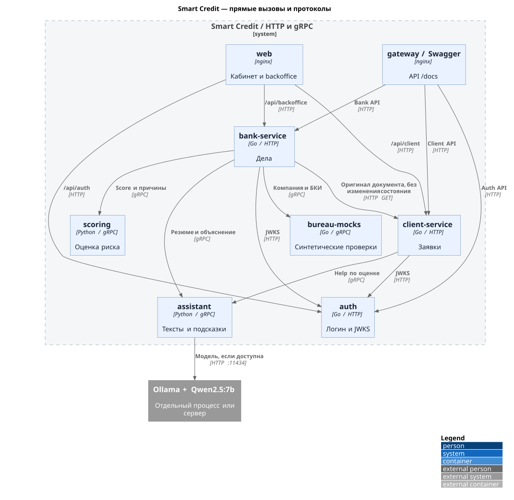

# Smart Credit

**Демо кредитования малого бизнеса.** Клиент подаёт заявку от имени компании; банк проверяет данные и правила продукта, а положительное решение утверждает аналитик. В браузере можно пройти путь от заявки и оферты до демо-подписи и статуса выдачи. `scoring` оценивает риск, а `assistant` формулирует текст — сами они кредит не одобряют.

## Быстрый старт для жюри

### 1. Подготовьте компьютер

- Установите и запустите **Docker** с плагином **Docker Compose v2** (Docker Desktop на macOS/Windows, Docker Engine с Compose на Linux). Выделите Docker не меньше 4 CPU и 8 ГБ памяти. На Windows команды ниже выполняйте в WSL2. Если Ollama работает на том же компьютере, ориентируйтесь на 16 ГБ общей памяти и более.
- Установите **`make`** и **Go** с поддержкой toolchain `1.27.1` из [go.mod](go.mod). Makefile использует Go для миграций и создания демо-учёток. При первом запуске понадобятся интернет и время на образы, модули Go и сборку контейнеров. Node.js и Python отдельно устанавливать не нужно.
- Проверьте `docker compose version`, `go version` и `make --version`. Убедитесь, что доступны порты стенда: `3000` (web), `8000` (Swagger/API), `8080`, `8081`, `8082`, `8083`, `5432`, `9092`, `50051`–`50053`. Их публикация задана в [Compose](deploy/docker-compose.yml); если порт занят, освободите его или измените соответствующую настройку.

### 2. Создайте локальный `.env`

```bash
cp .env.example .env
```

В `.env` замените три **демонстрационных** пароля из примера на значения для показа:

```dotenv
AUTH_DEV_CLIENT_PASSWORD=client
AUTH_DEV_ADMIN_PASSWORD=admin
AUTH_DEV_ANALYST_PASSWORD=analyst
```

Остальные значения из `.env.example` подходят для локального стенда. `.env` игнорируется Git; не добавляйте его в коммит. Учётные записи создаёт команда запуска:

| Роль | Логин | Пароль |
|---|---|---|
| Клиент | `client@smart-credit.test` | `client` |
| Клиент, ИП | `ip@smart-credit.test` | `client` |
| Клиент, отказ | `closing@smart-credit.test` | `client` |
| Администратор | `admin@smart-credit.test` | `admin` |
| Аналитик | `analyst@smart-credit.test` | `analyst` |

### 3. Установите и проверьте Ollama

**Ollama** — отдельная программа для запуска модели `Qwen2.5:7b`. Контейнер `assistant` обращается к её HTTP API и составляет подсказки клиенту, резюме дела и объяснения. **Кредитное решение, сумма и ставка определяются банковскими правилами и аналитиком, не моделью.** Если Ollama недоступна, проект показывает проверенный шаблон и кредитный сценарий продолжается.

Если Ollama уже работает на отдельном сервере, установку на компьютере жюри пропустите и укажите адрес сервера в `OLLAMA_URL` ниже. На Windows команды Ollama выполняйте в PowerShell, а `make demo-up` — в WSL2. Для локального показа:

1. **Установите программу.** На macOS или Windows скачайте установщик с [официальной страницы Ollama](https://ollama.com/download), установите и откройте приложение. На Linux выполните [официальную команду установки](https://docs.ollama.com/linux):

   ```bash
   curl -fsSL https://ollama.com/install.sh | sh
   ```

2. **Запустите сервер Ollama.** На macOS/Windows достаточно открытого приложения. При ручном запуске используйте `ollama serve` в отдельном терминале; если сервер уже запущен, второй экземпляр запускать не нужно. На Linux при установленной службе можно выполнить `sudo systemctl start ollama`. Проверьте, что локальный API отвечает:

   ```bash
   ollama --version
   curl -fsS http://localhost:11434/api/tags
   ```

   Второй вызов должен вернуть JSON с полем `models` (список может быть пуст до загрузки модели). В PowerShell вместо `curl -fsS ...` используйте `Invoke-RestMethod http://localhost:11434/api/tags`.

3. **Загрузите и запустите именно 7B.** Для первого скачивания нужен интернет и около 4,7 ГБ свободного места под [тег модели](https://ollama.com/library/qwen2.5%3A7b):

   ```bash
   ollama pull qwen2.5:7b
   ollama list
   ollama run qwen2.5:7b "Ответь одним словом: готово"
   ```

   В списке должен появиться `qwen2.5:7b`, а последняя команда должна вернуть текстовый ответ. Так проверяется сама модель **до** запуска Smart Credit. Веса не входят в Docker-образы и не скачиваются командой `make demo-up`.

4. **Проверьте подключение проекта.** В `.env` оставьте `OLLAMA_MODEL=qwen2.5:7b` и для Ollama на этом компьютере `OLLAMA_URL=http://host.docker.internal:11434`. Compose добавляет `host.docker.internal` для контейнера `assistant`. На Linux с Docker Engine Ollama по умолчанию слушает только `127.0.0.1`: для доступа контейнера настройте адрес прослушивания через [`OLLAMA_HOST`](https://docs.ollama.com/faq#how-can-i-expose-ollama-on-my-network), например `0.0.0.0:11434` для локального доверенного стенда. Для службы Ollama задайте `Environment="OLLAMA_HOST=0.0.0.0:11434"` через `sudo systemctl edit ollama.service`, затем выполните `sudo systemctl daemon-reload` и `sudo systemctl restart ollama`. Для уже развёрнутой Ollama замените URL на адрес, доступный **из контейнера**, и убедитесь, что на сервере загружен тот же тег. Оставьте `LLM_MODEL` пустым, чтобы использовался `OLLAMA_MODEL`. Если ответы 7B не успевают за банковским таймаутом, задайте `BANK_ASSISTANT_TIMEOUT=20s` в `.env` перед запуском; скорость зависит от оборудования.

После `make demo-up` выполните `make assistant-smoke`: он проверяет вызовы `assistant` через gRPC. В успешном выводе ожидается версия `qwen2.5:7b`; `template` означает, что модель не ответила вовремя или текст не прошёл проверку. Тогда посмотрите `make assistant-logs`, `ollama list` и `OLLAMA_URL`. Дополнительная диагностика — в [README assistant](ml/assistant/README.md).

### 4. Запустите демо одной командой

```bash
make demo-up
```

Команда поднимает инфраструктуру, сервисы, `web` и Swagger, применяет миграции и загружает демо-учётки и данные банка. Откройте [кабинет клиента](http://localhost:3000/cabinet), [рабочее место банка](http://localhost:3000/bank) или [Swagger](http://localhost:8000/docs/). Адреса соответствуют портам по умолчанию из `.env.example`.

**Показать полный путь:** войдите как `client@smart-credit.test`, заполните профиль компании с ИНН `7707083893` и выберите продукт «Демо: денежный поток» (`SME_CASHFLOW_V2`). Создайте черновик на **5 000 000 ₽ / 12 месяцев** для оборотных средств; в поле минимальной суммы укажите **1 000 000 ₽**, чтобы банк мог предложить меньший вариант при нехватке денежного потока. Заполните обязательные поля, отправьте заявку и дождитесь расчётных вариантов. Затем войдите как `analyst@smart-credit.test` в `/bank`, откройте дело, возьмите его в работу и подтвердите актуальный вариант. Вернитесь в кабинет клиента: примите опубликованную оферту, выполните демо-подпись и дождитесь `DISBURSED`. Варианты до подтверждения аналитиком **не являются офертами**. Поля и альтернативные клиентские исходы — в [README client-service](services/client-service/README.md), действия аналитика и банковские статусы — в [README bank-service](services/bank-service/README.md).

Ollama остаётся отдельным процессом: `make infra-down` останавливает Compose-стенд, но не Ollama. Если интерфейс показывает «Ответ по шаблону» или «Шаблонный текст», выполните проверку из шага 3 и посмотрите `make assistant-logs`.

Проверить контейнеры: `make infra-ps`; посмотреть логи: `make infra-logs`; остановить стенд с сохранением томов: `make infra-down`.

### Публичный стенд

Если локальный запуск не нужен, в `main` указан [развёрнутый кабинет](https://185.149.147.246/cabinet) с синтетическими данными и готовыми заявками. Учётные записи те же, но пароли стенда выдаются отдельно и отличаются от паролей локального демо выше.

## Что реализовано и где границы MVP

Есть профиль компании, каталог продуктов, черновик и документы, отправка заявки, запрос недостающих данных, проверки, автоматический запрос данных или отказ и ручное подтверждение оферты, оферта и контрпредложение, принятие/отказ, отзыв, истечение срока, демо-подпись и демо-выдача. Для продукта `SME_CASHFLOW_V2` также реализована отдельная экспертная оценка денежного потока с расчётными вариантами и подтверждением аналитика ([описание v2](docs/ASSESSMENT_V2.md)). `DECISION` означает **ожидание применения банковских правил** после оценки, а не одобрение: результатом могут стать запрос данных, ручной разбор или отказ; оферту после положительной оценки подтверждает аналитик.

Бизнес-состояние между `client-service` и `bank-service` передаётся через Kafka (`client.events`, `bank.events`), без общего доступа к их БД. Техническое исключение: банк читает уже отправленный оригинал документа защищённым HTTP GET в `client-service`; этот вызов не меняет состояние заявки.

Для локального MVP бюро возвращает синтетические данные; скоркарты v1 и v2 экспертные, без статистической калибровки вероятности дефолта. Подпись и выдача симулируются. Документ проверяется по формату и сохраняется, но значения из него автоматически не извлекаются. Локальная модель для `assistant` запускается отдельно; при её отсутствии работает шаблон. Возможные следующие шаги, требующие отдельной реализации: адаптеры реальных проверок, извлечение данных из документов, калибровка скоринга на разрешённых исторических данных, юридически значимая подпись и настоящая выдача. Сроки этих работ не заданы.

## Архитектура


Прямые вызовы между сервисами и их протоколы:



Изменения бизнес-состояния между `client-service` и `bank-service` проходят через Kafka; прямой HTTP GET банка к клиенту читает только уже отправленный документ. Оригиналы документов и приватный ключ `auth` находятся в отдельных Docker volumes.

[Исходники PlantUML и обновление схем](docs/diagrams/README.md) · [Compose](deploy/docker-compose.yml) · [ТЗ](TZ.md) · [API-контракты](api/README.md)

| Компонент | Кратко | Подробный README |
|---|---|---|
| `web` | Кабинет клиента и рабочее место банка. | [web](web/README.md) |
| `gateway` / Swagger | Единый API-адрес и просмотр контрактов. | [deploy](deploy/README.md) |
| `auth` | Учётки, роли и токены. | [auth](services/auth/README.md) |
| `client-service` | Клиентская заявка и её публичное состояние. | [client-service](services/client-service/README.md) |
| `bank-service` | Банковское дело, правила и решение. | [bank-service](services/bank-service/README.md) |
| `bureau-mocks` | Синтетические проверки. | [bureau-mocks](services/bureau-mocks/README.md) |
| `scoring` | Оценка риска. | [scoring](ml/scoring/README.md) |
| `assistant` | Тексты и резюме. | [assistant](ml/assistant/README.md) |

Дополнительные материалы: [техническая архитектура и состояния дела](docs/ARCHITECTURE.md), [модель данных](docs/DATA_MODEL.md), [тестовые сценарии](docs/TEST_SCENARIOS.md).
