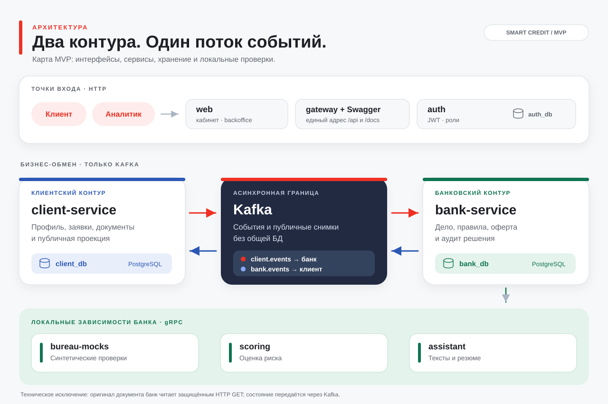

# Smart Credit

**Демо кредитования малого бизнеса.** Клиент подаёт заявку от имени компании; банк проверяет данные и принимает решение по правилам продукта или через аналитика. В браузере можно пройти путь от заявки и оферты до демо-подписи и статуса выдачи. `scoring` оценивает риск, а `assistant` формулирует текст — сами они кредит не одобряют.

## Быстрый старт для жюри

### 1. Подготовьте компьютер

- Установите и запустите **Docker** с плагином **Docker Compose v2** (Docker Desktop на macOS/Windows, Docker Engine с Compose на Linux). Выделите Docker не меньше 4 CPU и 8 ГБ памяти. На Windows команды ниже выполняйте в WSL2.
- Установите **`make`** и **Go** с поддержкой toolchain `1.27.1` из [go.mod](go.mod). Makefile использует Go для миграций и создания демо-учёток. При первом запуске понадобятся интернет и время на образы, модули Go и сборку контейнеров. Node.js и Python отдельно устанавливать не нужно.
- Проверьте `docker compose version`, `go version` и `make --version`. Убедитесь, что доступны порты стенда: `3000` (web), `8000` (Swagger/API), `8080`, `8081`, `8082`, `8083`, `5432`, `9092`, `50051`–`50053`. Их публикация задана в [Compose](deploy/docker-compose.yml); если порт занят, освободите его или измените соответствующую настройку.

### 2. Создайте локальный `.env`

```bash
cp .env.example .env
```

В `.env` замените три **демонстрационных** пароля из примера на значения для показа:

```dotenv
AUTH_DEV_CLIENT_PASSWORD=client
AUTH_DEV_ADMIN_PASSWORD=admin
AUTH_DEV_ANALYST_PASSWORD=analyst
```

Остальные значения из `.env.example` подходят для локального стенда. `.env` игнорируется Git; не добавляйте его в коммит. Учётные записи создаёт команда запуска:

| Роль | Логин | Пароль |
|---|---|---|
| Клиент | `client@smart-credit.test` | `client` |
| Клиент, ИП | `ip@smart-credit.test` | `client` |
| Клиент, отказ | `closing@smart-credit.test` | `client` |
| Администратор | `admin@smart-credit.test` | `admin` |
| Аналитик | `analyst@smart-credit.test` | `analyst` |

### 3. Подготовьте Ollama для показа AI

**Ollama** — отдельная программа, которая запускает модель на компьютере или сервере. `assistant` обращается к ней по HTTP, чтобы сформулировать подсказку клиенту, резюме дела и текст объяснения. Модель **не выбирает кредитное решение, сумму или ставку**: их определяет и проверяет банковский код. Если Ollama недоступна, сервис возвращает проверенный шаблон и кредитный сценарий продолжается.

Для показа ответов модели установите [Ollama](https://ollama.com/download), запустите приложение (или `ollama serve`, если используете CLI без уже запущенного приложения), затем выполните на том же компьютере:

```bash
ollama pull qwen2.5:7b
ollama list
ollama run qwen2.5:7b "Ответь одним словом: готово"
```

Загрузка модели выполняется **до** `make demo-up`: Compose не устанавливает Ollama и не скачивает веса. [Тег `qwen2.5:7b`](https://ollama.com/library/qwen2.5%3A7b) занимает около 4,7 ГБ; скорость ответа зависит от ресурсов компьютера. В `.env` проверьте:

```dotenv
OLLAMA_MODEL=qwen2.5:7b
OLLAMA_URL=http://host.docker.internal:11434
# Для показа текста модели при медленном ответе:
BANK_ASSISTANT_TIMEOUT=20s
```

Этот URL соединяет контейнер `assistant` с Ollama на компьютере жюри. Если Ollama уже развёрнута на отдельном сервере, укажите в `OLLAMA_URL` доступный контейнеру адрес этого сервера. Пустой `LLM_MODEL` в `.env.example` означает, что используется `OLLAMA_MODEL`. Подробная настройка и проверка — в [README assistant](ml/assistant/README.md).

### 4. Запустите демо одной командой

```bash
make demo-up
```

Команда поднимает инфраструктуру, сервисы, `web` и Swagger, применяет миграции и загружает демо-учётки и данные банка. Откройте [кабинет клиента](http://localhost:3000/cabinet), [рабочее место банка](http://localhost:3000/bank) или [Swagger](http://localhost:8000/docs/). Адреса соответствуют портам по умолчанию из `.env.example`.

**Показать полный путь:** войдите как `client@smart-credit.test`, заполните профиль компании с ИНН `7707083893` и выберите продукт «Демо: денежный поток» (`SME_CASHFLOW_V2`). Создайте черновик на **5 000 000 ₽ / 12 месяцев** для оборотных средств, заполните обязательные поля, отправьте заявку и дождитесь расчётных вариантов. Затем войдите как `analyst@smart-credit.test` в `/bank`, откройте дело, возьмите его в работу и подтвердите актуальный вариант. Вернитесь в кабинет клиента: примите опубликованную оферту, выполните демо-подпись и дождитесь `DISBURSED`. Варианты до подтверждения аналитиком **не являются офертами**. Поля и альтернативные клиентские исходы — в [README client-service](services/client-service/README.md), действия аналитика и банковские статусы — в [README bank-service](services/bank-service/README.md).

После запуска Ollama остаётся отдельным процессом; `make infra-down` останавливает только Compose-стенд. Если интерфейс показывает «Ответ по шаблону» или «Шаблонный текст», проверьте `ollama list`, адрес `OLLAMA_URL` и логи `make assistant-logs`.

Проверить контейнеры: `make infra-ps`; посмотреть логи: `make infra-logs`; остановить стенд с сохранением томов: `make infra-down`.

## Что реализовано и где границы MVP

Есть профиль компании, каталог продуктов, черновик и документы, отправка заявки, запрос недостающих данных, проверки, автоматические правила и ручное решение, оферта и контрпредложение, принятие/отказ, отзыв, истечение срока, демо-подпись и демо-выдача. Для продукта `SME_CASHFLOW_V2` также реализована отдельная экспертная оценка денежного потока с расчётными вариантами и подтверждением аналитика ([описание v2](docs/ASSESSMENT_V2.md)). `DECISION` означает **ожидание применения банковских правил** после оценки, а не одобрение: результатом могут стать оферта, запрос данных, ручной разбор или отказ.

Бизнес-состояние между `client-service` и `bank-service` передаётся через Kafka (`client.events`, `bank.events`), без общего доступа к их БД. Техническое исключение: банк читает уже отправленный оригинал документа защищённым HTTP GET в `client-service`; этот вызов не меняет состояние заявки.

Для локального MVP бюро возвращает синтетические данные; скоркарты v1 и v2 экспертные, без статистической калибровки вероятности дефолта. Подпись и выдача симулируются. Документ проверяется по формату и сохраняется, но значения из него автоматически не извлекаются. Локальная модель для `assistant` запускается отдельно; при её отсутствии работает шаблон. Возможные следующие шаги, требующие отдельной реализации: адаптеры реальных проверок, извлечение данных из документов, калибровка скоринга на разрешённых исторических данных, юридически значимая подпись и настоящая выдача. Сроки этих работ не заданы.

## Архитектура



[Исходник и обновление схемы](docs/diagrams/README.md) · [Compose](deploy/docker-compose.yml) · [ТЗ](TZ.md) · [API-контракты](api/README.md)

| Компонент | Кратко | Подробный README |
|---|---|---|
| `web` | Кабинет клиента и рабочее место банка. | [web](web/README.md) |
| `gateway` / Swagger | Единый API-адрес и просмотр контрактов. | [deploy](deploy/README.md) |
| `auth` | Учётки, роли и токены. | [auth](services/auth/README.md) |
| `client-service` | Клиентская заявка и её публичное состояние. | [client-service](services/client-service/README.md) |
| `bank-service` | Банковское дело, правила и решение. | [bank-service](services/bank-service/README.md) |
| `bureau-mocks` | Синтетические проверки. | [bureau-mocks](services/bureau-mocks/README.md) |
| `scoring` | Оценка риска. | [scoring](ml/scoring/README.md) |
| `assistant` | Тексты и резюме. | [assistant](ml/assistant/README.md) |
