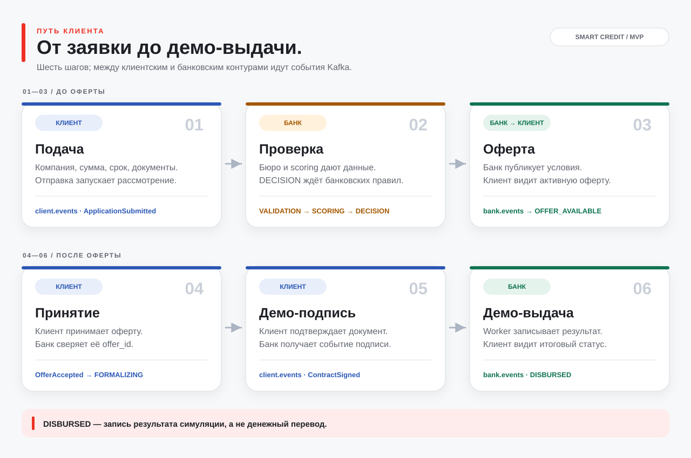

# Smart Credit

**Демо кредитного пути для малого бизнеса:** клиент заполняет профиль компании и подаёт заявку, банк проверяет данные и принимает решение по своим правилам или через аналитика. Клиент видит предложение, принимает его, выполняет демо-подпись и получает статус демо-выдачи. `scoring` оценивает риск, а `assistant` помогает сформулировать текст; ни один из них не утверждает кредит самостоятельно.

> [Техническое задание](TZ.md) · [HTTP и protobuf-контракты](api/README.md) · [сценарии Postman](postman/README.md) · [подробности web](web/README.md)

## Быстрый старт MVP

Нужны запущенный Docker Engine с Compose, `make` и Go с поддержкой toolchain из [go.mod](go.mod) (`1.27.1`): Makefile запускает Go-команды для миграций и локальных учёток. Первый запуск скачивает образы и зависимости. Для просмотра через браузер или Swagger отдельная локальная установка Python и Node.js не нужна.

```bash
cp .env.example .env
# В локальном .env задайте AUTH_DEV_CLIENT_PASSWORD,
# AUTH_DEV_ANALYST_PASSWORD и AUTH_DEV_ADMIN_PASSWORD.
# Проверьте порты и адрес модели для своего окружения.
make demo-up
```

`.env` игнорируется Git. Не добавляйте в README, коммиты или Postman-коллекции реальные пароли, ключи и токены. `demo-up` поднимает Postgres, Kafka, auth, client-service, bank-service, scoring, bureau-mocks, assistant, Swagger/gateway и демоданные банка. Web запускается **отдельно**: `make web-up` → [http://localhost:3000](http://localhost:3000). Swagger с работающим `Try it out`: [http://localhost:8000/docs/](http://localhost:8000/docs/) при стандартном `GATEWAY_PORT`. Только каталог контрактов можно открыть через `make docs-up` → [http://localhost:8081](http://localhost:8081).

**Один путь от заявки до выдачи.** Проще всего запустить готовую коллекцию [Smart-Credit-Sign-Disburse](postman/Smart-Credit-Sign-Disburse.postman_collection.json): импортируйте её и [локальное окружение](postman/Smart-Credit-Local.postman_environment.json), заполните в Postman `client_password` и `analyst_password` значениями из *своего* `.env`, укажите рабочую папку `postman` для демо-файла и запустите Collection Runner на одну итерацию. Коллекция создаёт **новую** заявку, дожидается банковской оферты, принимает её, отправляет демо-подпись и проверяет `DISBURSED` у клиента и банка. Пошаговая настройка Runner и остальные исходы — в [postman/README.md](postman/README.md). В интерфейсе web этот же путь проходит клиентская роль (`/cabinet`); решение вручную принимает аналитик (`/bank`). Учётки создаёт `make demo-up`, адреса и роли — в [README auth](services/auth/README.md).

Для проверки стенда: `make infra-ps`; логи — `make infra-logs`, `make client-logs`, `make bank-logs`. Остановить Compose-стек с сохранением томов: `make infra-down`.

## Границы MVP и принятые решения

Реализованы профиль и каталог, черновик с документами, отправка и ответ на запрос данных, проверки по локальным bureau-mocks, scoring, автоматические правила банка и ручное решение аналитика, оферта или контрпредложение, принятие/отказ, отзыв, истечение оферты, демо-подпись и демо-выдача. Статус `DECISION` — **ожидание применения банковских правил после оценки**, а не одобрение. Правила могут привести к оферте, запросу данных, ручному разбору или отказу.

Бизнес-обмен между клиентским и банковским контурами идёт через **Kafka**, без прямого вызова одного сервиса другим для смены состояния: `client.events` несёт действия клиента, `bank.events` — публичное состояние и каталог. Есть одно техническое исключение в текущем коде: для просмотра уже отправленного оригинала документа сотрудником банк проксирует защищённый `GET` в client-service; документы и состояние между БД напрямую не читаются. [Контракт маршрута](api/bank.yaml) и [реализация клиента](services/client-service/README.md) описывают права доступа.

Это локальный прототип: bureau-mocks использует синтетические персоны, scoring v1 — экспертную скоркарту без калибровки вероятности дефолта, а `DISBURSED` означает запись результата симуляции, не денежный перевод. Assistant может использовать локальную модель, но при её недоступности основной путь использует шаблон. Отдельного клиентского чата нет.

## Архитектура


[PlantUML-схема](docs/diagrams/architecture.puml) · [исходник SVG на D3](docs/diagrams/render.mjs) · [как обновить схемы](docs/diagrams/README.md) · [Compose-конфигурация](deploy/docker-compose.yml)

| Компонент | Ответственность и входы → выходы | Подробности |
|---|---|---|
| **web** | Кабинет клиента и рабочее место аналитика; HTTP через `/api` → действия и статусы двух ролей. | [web/README.md](web/README.md) |
| **gateway / Swagger UI** | Отдельная точка входа для документации и `Try it out`; HTTP `/api` и `/docs` → соответствующий API и OpenAPI. | [deploy/README.md](deploy/README.md) |
| **auth** | Логин и роли; HTTP → access JWT, refresh-cookie и JWKS; хранит пользователей в `auth_db`. | [services/auth/README.md](services/auth/README.md) |
| **client-service** | Профиль, каталог, заявки и документы; HTTP клиента + `bank.events` → `client_db`, `client.events` и публичная проекция. | [services/client-service/README.md](services/client-service/README.md) |
| **bank-service** | Дела, проверки, правила, аналитик, оферты и аудит; `client.events` + Bank API → `bank_db`, `bank.events`; вызывает gRPC-зависимости. | [services/bank-service/README.md](services/bank-service/README.md) |
| **bureau-mocks** | Детерминированные ответы по вымышленным ИНН; gRPC запрос банка → профиль компании и кредитная история из `seed/personas.yaml`. | [services/bureau-mocks/README.md](services/bureau-mocks/README.md) |
| **scoring** | Оценка риска; gRPC снимок признаков → score, grade и причины, без кредитного решения. | [ml/scoring/README.md](ml/scoring/README.md) |
| **assistant** | Резюме для аналитика и текст объяснения; gRPC от банка → текст или шаблон, без изменения решения. | [ml/assistant/README.md](ml/assistant/README.md) |

`gateway` (nginx) даёт единый адрес Swagger и API. Один контейнер Postgres содержит отдельные `auth_db`, `client_db`, `bank_db`; Kafka работает как один локальный KRaft-брокер. Web может обслуживать `/api` своим nginx. Подробнее о конфигурации — в [Makefile](Makefile) и [Compose](deploy/docker-compose.yml).

## Путь клиента



Это обзорный маршрут. Подробные последовательности сообщений сохранены в PlantUML: [заявка → оферта](docs/diagrams/client-journey.puml) и [принятие → демо-выдача](docs/diagrams/fulfillment.puml). После submit ответ клиенту может показывать отправку, пока банк не опубликует следующую версию публичного состояния: интерфейс обновляет его через GET.

### Другие исходы

| Ветка | Действие | Итог после события банка |
|---|---|---|
| **Decline** | Клиент отказывается от активной оферты (`OfferDeclined`). | Банк `CANCELLED`, клиент `CLOSED`. |
| **Cancel** | Клиент отзывает заявку до подписи (`ApplicationCancelled`). | Банк `CANCELLED`, клиент `CLOSED`. |
| **Expiry** | Срок активной оферты проходит; банковский worker проверяет `expires_at`. | Банк `EXPIRED`, клиент `CLOSED`. |
| **Ручное решение** | Назначенный аналитик берёт `MANUAL_REVIEW` и выбирает `APPROVE`, `COUNTER`, `REQUEST_INFO` или `REJECT`. | Оферта, запрос данных либо отказ. |

## Состояния и события

У банка и клиента **разные** статусы. Клиент видит публичную проекцию, а промежуточные действия до ответа банка отображаются как pending.

| Банк (`BankStatus`) | Что видит клиент (`ClientStatus`) | Смысл |
|---|---|---|
| — | `DRAFT` | Локальный черновик ещё не передан банку. |
| `SUBMITTED`, `VALIDATION`, `ENRICHMENT`, `SCORING`, `DECISION`, `MANUAL_REVIEW` | `SUBMITTED` / `UNDER_REVIEW` | Отправка и рассмотрение; `DECISION` ещё не итог. |
| `NEEDS_INFO` | `NEEDS_INFO` | Банк ждёт конкретные сведения или документы. |
| `OFFER`, `COUNTER_OFFER` | `OFFER_AVAILABLE` | Есть активная оферта с ограниченным сроком. |
| `OFFER_ACCEPTED`, `SIGNING` | `FORMALIZING` | Принятие подтверждено; доступна демо-подпись. |
| `DISBURSED` | `DISBURSED` | Демо-выдача после подписи. |
| `REJECTED` | `REJECTED` | Отказ с публичным объяснением. |
| `CANCELLED`, `EXPIRED` | `CLOSED` | Отзыв, отказ от оферты или окончание её срока. |

| Топик | События из [`proto/events/events.proto`](proto/events/events.proto) | Направление |
|---|---|---|
| `client.events` | `ApplicationSubmitted`, `InfoProvided`, `OfferAccepted`, `OfferDeclined`, `ContractSigned`, `ApplicationCancelled` | client-service → bank-service |
| `bank.events` | `ApplicationPublicStatePublished`, `ProductCatalogPublished` | bank-service → client-service |

У события есть `event_id`, `aggregate_id`, `aggregate_version`, время и `correlation_id`; ключ Kafka равен `aggregate_id` (для каталога — `catalog`). Версии монотонны в рамках агрегата **и отправителя**. Outbox записывает изменение БД и событие в одной транзакции, relay публикует их по порядку версий. Доставка at least once допускает повтор после сбоя; consumer сохраняет `processed_events` и проверяет версию, а клиент применяет только более свежий публичный снимок. Полный публичный снимок банка не содержит внутренних комментариев, причин из БКИ и score. [Детали контракта](api/README.md).

## Разработка и проверка

| Задача | Команда или каталог |
|---|---|
| Список команд | `make help` |
| Инфраструктура и Swagger | `make infra-up`, `make infra-ps`, `make docs-up`, `make gateway-up` |
| Go-проверки | `go test ./...`, `make lint` |
| Тесты с отдельной PostgreSQL | `make auth-test`, `make client-test`; адреса `AUTH_TEST_DATABASE_URL` и `CLIENT_TEST_DATABASE_URL` задаются локально |
| Банковые интеграционные проверки | `make bank-decision-test`, `make bank-outbox-test`, `make bank-signing-test`, `make bank-offer-expiry-test` (нужна `bank_db`) |
| Python scoring | `make scoring-test scoring-lint` |
| Контракты | [api/*.yaml](api/README.md), [proto/*](proto/events/events.proto); `make gen`, `make gen-proto-check`, `make web-gen` |
| Миграции | [auth](services/auth/migrations/README.md), [client](services/client-service/migrations/README.md), [bank](services/bank-service/migrations/README.md); `make auth-db-status client-db-status bank-db-status` |
| Сквозные сценарии | [postman/README.md](postman/README.md) и коллекции в `postman/` |

## Известные ограничения и следующие шаги

- Данные bureau-mocks, продукты и демо-дела локальные; реальных кредитных бюро и денежной выдачи нет. Для внешней интеграции понадобятся отдельные адаптеры и проверка требований к данным.
- Scoring v1 — экспертная модель без калибровки вероятности дефолта. Для реализованной оценки денежного потока v2 есть отдельные [описание](docs/ASSESSMENT_V2.md) и [runbook](docs/ASSESSMENT_RUNBOOK.md).
- Файлы клиента хранятся в локальном Docker volume; проверяются формат и метаданные, но суммы и реквизиты из PDF/Excel/изображений автоматически не извлекаются.
- Локальная модель для assistant запускается отдельно от Compose. При её отсутствии используется шаблон; проверку качества с реальной моделью проводят отдельно по [README assistant](ml/assistant/README.md).
- При изменении схем сначала обновляйте [OpenAPI и protobuf](api/README.md), затем generated-код и сценарии. Для новых внешних зависимостей и настоящей выдачи потребуется отдельная реализация; сроков здесь нет.
