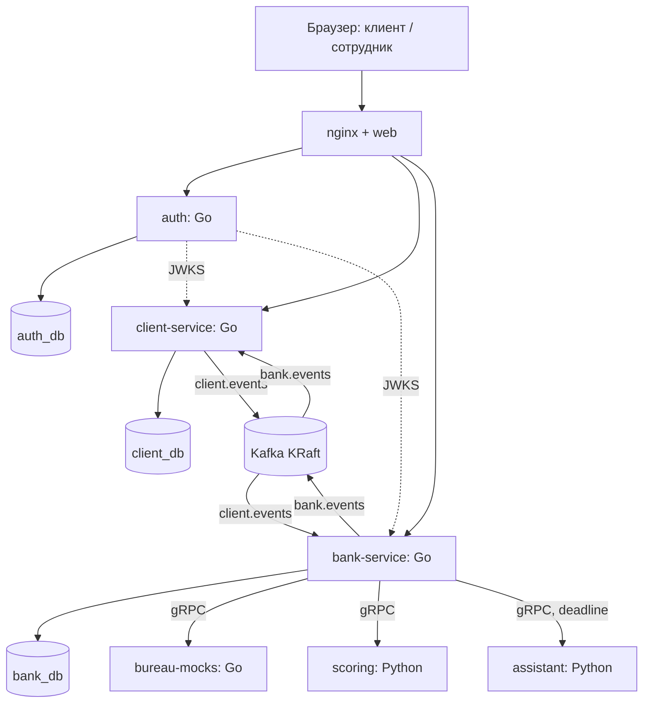

# Умный кредитный кабинет — техническое задание для команды

**Дедлайн:** 26.10.2026  
**Команда:** 2 backend-разработчика (Go), 2 ML-разработчика (Python).  
**Статус:** рабочий план и архитектурное решение; HTTP/protobuf-контракты фиксируем в репозитории первыми.

## 1. Цель, границы и критерий готовности

Нужен работающий веб-прототип кредитного конвейера для малого и микробизнеса. Представитель компании понимает, какой продукт ему подходит, заполняет заявку, видит движение заявки и результат. Сотрудник банка видит дело, результаты проверок, оценку риска и может принять решение там, где автоматического решения нет. Все данные сохраняются; после перезапуска стек продолжает сценарий.

**Обязательный сквозной сценарий (M):** вход клиента → профиль компании → каталог → черновик → заполнение и условные документы → отправка → банк проверяет данные и вызывает моки источников и scoring → автоматическое предложение **либо** ручной разбор → клиент видит статус → принимает предложение → имитация подписания и выдачи. Отдельные тестовые персоны должны воспроизводить запрос данных, контрпредложение и отказ.

**После работающего M (S):** улучшения очереди и интерфейса. Статусы в MVP обновляются через polling.

**Часть M:** assistant на открытых весах для резюме дела аналитику и объяснения решения клиенту; при ошибке модели используется шаблонный текст. **Только если осталось время (C):** семантический подбор продукта и облачное демо.

Не делаем реальный БКИ/ФНС/ЕГРЮЛ, реальную электронную подпись и выдачу денег, почту/SMS/мессенджеры в пользовательском пути, платные API, закрытые модели или мобильное приложение. Демо работает на синтетических данных локально в Docker.

**Definition of Done для M:** `docker compose up --build` на обычном ПК поднимает стек; тестовый клиент проходит сценарий через браузер; аналитик завершает ручное дело; есть воспроизводимые персоны для пяти исходов, включая контрпредложение другого продукта; в карточке банка видно резюме assistant, а клиенту — объяснение уже принятого решения; при сбое assistant возвращается шаблонный текст и исход заявки не меняется; `README` ведёт по сценарию; публичные HTTP-контракты и диаграммы соответствуют коду; тесты критичных правил проходят; финальный commit/tag зафиксирован до 26.10.

### Сверка с кейсом хакатона

| Ожидаемое поведение из кейса | Что должно работать в прототипе |
|---|---|
| Клиент определяет потребность и выбирает кредитный продукт | Каталог и карточка продукта показывают цель, диапазоны и документы; выбор создаёт черновик. |
| Клиент проходит путь от заявки до результата | Заполнение, загрузка демо-документов, отправка, актуальный статус, ответ банку, оферта, демо-подпись и итог доступны в веб-кабинете. |
| Банк проверяет полноту, данные компании и кредитную историю | Валидация заявки и документов; локальные моки ЕГРЮЛ/ФНС/БКИ; результаты видны аналитику. |
| Скоринг и кредитное решение — разные этапы | Scoring возвращает оценку риска и причины; bank-service применяет правила продукта и фиксирует итог. |
| Результат не ограничен одобрением и отказом | Воспроизводятся запрос данных, ручной разбор и контрпредложение, в том числе другого продукта, суммы или срока. |
| Данные сохраняются, а состояние реагирует на действия | Состояния, аудит и outbox сохраняются в БД; client и bank синхронизируются через Kafka; web обновляет статус через GET. |
| Решение можно проверить самостоятельно | Compose, seed-персоны, README, OpenAPI, коллекция запросов, схема архитектуры и состояний, модель данных и сценарии проверки входят в сдачу. |

Новостная лента относится к соседнему заданию и не входит в объём этого проекта.

## 2. Ответственности и результаты

| Направление / владелец | Что делает к M | Что сдаёт и с кем согласует |
|---|---|---|
| **Backend-1 (Go, владелец архитектуры банка)** | `bank-service`: приём событий, дело, конвейер, decision engine, очередь/карточка/решение аналитика, аудит; `bureau-mocks`; схема событий банка. | `api/bank.yaml`, `proto/bureau`, `proto/events` совместно с Backend-2, миграции `bank_db`, тесты переходов и правил, seed сценариев. Согласует вход scoring с ML-1. |
| **Backend-2 (Go, владелец клиентского контура и интеграции web)** | `auth`, `client-service`: логин/JWT/JWKS, профиль/каталог/заявка, outbox, проекция `bank.events`; общая Kafka/HTTP инфраструктура по необходимости. Собирает и связывает web с API. | `api/auth.yaml`, `api/client.yaml`, миграции `auth_db` и `client_db`, клиентские события, seed учёток, работающий web flow. Контракты согласует с Backend-1 до реализации. |
| **ML-1 (Python, владелец scoring)** | Согласует список признаков и protobuf, строит воспроизводимый прозрачный скоринг, возвращает score/grade/причины; готовит синтетические тестовые случаи. | `proto/scoring`, сервис `scoring`, фиксированная модель/конфиг, описание признаков и интерпретации, тесты на персонах. Порог решения не прячет в модели — передаёт банку grade/score. |
| **ML-2 (Python, владелец данных и assistant)** | Готовит тестовые персоны и assistant по согласованному protobuf: резюме дела и объяснение решения. Проверяет ценность текста на демо-кейсах. | `seed/personas.yaml`, описание данных и сценариев, `assistant` с открытыми весами и шаблонным fallback. Недоступность модели не останавливает кредитный конвейер. |
| **Web (временно Backend-2, при участии всей команды в приёмке)** | Генерируемый клиентский кабинет и рабочее место аналитика: маршрут по роли, формы, очередь, карточки, статусы, ошибки, загрузка условного документа. | `web/`, собранная статика, e2e проход в браузере. Backend-1 проверяет аналитический экран; ML-1 проверяет отображение причин скоринга. |

Если распределение людей меняется, владельцы модулей меняются в README, но контракты и границы сервисов остаются. Frontend — явная работа команды, а не «доделаем после backend». К 22.10 должны существовать кликабельные экраны на моках контрактов.

## 3. Итоговый стек и топология

**Go:** `net/http` + `chi`, `oapi-codegen` для типов/strict server, `pgx/v5` с SQL без ORM, `goose` для миграций, `franz-go` для Kafka, `grpc-go` и `buf` для protobuf, `slog` + OpenTelemetry для логов/трасс. Версии фиксировать в `go.mod`/`go.sum`; общие адаптеры положить в `pkg/`, а не копировать между сервисами.

**ML:** Python, gRPC, зафиксированные зависимости (`uv.lock` или эквивалент), прозрачная скоркарта либо логистическая регрессия. Для assistant — только модель с открытыми весами и локальный запуск; при сбое шаблонный fallback.

**Web:** React + Vite + TypeScript, обычный HTML/CSS в компонентах, без SSR и отдельного Node-сервера в runtime; `openapi-typescript` генерирует типы, `openapi-fetch` вызывает API. Статику отдаёт nginx. Это самый удобный для быстро генерируемого интерфейса вариант: страницы и компоненты легко менять, а типы ловят расхождения с API. Простого HTML/CSS/JS хватило бы для одного экрана, но здесь две роли, много форм и состояний. Не добавлять UI-фреймворк, сложный state manager и дизайн-систему без реальной необходимости.

**Инфраструктура:** один Postgres-контейнер с `auth_db`, `client_db`, `bank_db` и отдельными ролями; Kafka в KRaft с одним брокером; nginx как единая точка входа (`/` → web, `/api/auth` → auth, `/api/client` → client-service, `/api/backoffice` → bank-service). Все сервисы в `deploy/docker-compose.yml`; наружу обязательно открыт только nginx. TLS в локальном демо может завершаться за пределами compose; cookie-настройки для localhost и публичного HTTPS различаются конфигом.



**Главная граница:** client-service и bank-service не читают БД друг друга и не вызывают друг друга по HTTP/gRPC. На этом стыке только события Kafka. `auth` владеет учётками; остальные проверяют JWT локально по JWKS. `bank-service` вызывает `bureau-mocks`, `scoring` и `assistant` по gRPC с дедлайнами. Assistant формирует текст, но не меняет решение; при таймауте используется шаблон. Отдельного клиентского чата в текущем объёме нет. Подбор продукта на клиенте для M — детерминированный по тегам каталога.

## 4. Структура репозитория и правило контрактов

```text
api/                 auth.yaml, client.yaml, bank.yaml, common.yaml
proto/               common, events, scoring, bureau, assistant
services/            auth/, client-service/, bank-service/, bureau-mocks/
ml/                  scoring/, assistant/
web/                 React + Vite + TypeScript
pkg/                 общая Go-инфраструктура: Kafka, outbox, JWT, problem, telemetry
seed/                personas.yaml, products.yaml, тестовые аккаунты и документы
deploy/              docker-compose.yml, nginx.conf, Dockerfiles, init-db
docs/                схема, модель данных, диаграмма состояний, контракты событий
tests/e2e/           основной сценарий и тестовые персоны
README.md            запуск, конфигурация, пошаговая проверка
THIRD_PARTY_NOTICES  компоненты, модели, данные и смоделированные интеграции
Makefile             gen, lint, test, up, seed, e2e
```

HTTP-спеки — OpenAPI 3.1 (`api/*.yaml`), gRPC и события — protobuf (`proto/*`). Сначала согласовать DTO: поля заявки, профиль, статусы, score и reason codes. После этого генерировать Go-обвязку и TS-типы. `generated/` не редактируется вручную; `make gen` воспроизводим, CI/локальная проверка сравнивает результат с коммитом. Из OpenAPI подготовить коллекцию Bruno/Postman. Конкретную версию кодогенератора и поддерживаемые им конструкции OpenAPI проверить на минимальной спеки 20.10; при несовместимости перейти на OpenAPI 3.0.3 без переделки маршрутов.

### Общие правила HTTP

- Браузер ходит на тот же origin через `/api`, без CORS между компонентами. В OpenAPI задан `servers: /api`; например, браузер вызывает `/api/client/products`, а внутренний handler обслуживает `/client/products`.
- JSON UTF-8; UUID для идентификаторов; RFC 3339 UTC для времени; сумма — целые копейки и `currency: RUB`; ставка — целые basis points; срок — месяцы. Никаких `float` для денег и ставок.
- Bearer JWT везде, кроме `login`, `refresh`, JWKS, `healthz`/`readyz`. Для клиента организацию берём из claim `org_id`, затем проверяем владение записью. Для сотрудника — роли `ANALYST`/`ADMIN`. Не принимаем `org_id` из клиентского body как полномочие.
- Ошибки в `application/problem+json`: `type`, `title`, `status`, `detail`, `code`, `trace_id`. `400` синтаксис, `401` нет сессии, `403` роль/право, `404` чужая или отсутствующая запись, `409` переход/конкурентная запись, `422` бизнес-валидация, `503` временная зависимость.
- Все state-changing `POST` с возможным повтором принимают `Idempotency-Key` (UUID); ключ храним с `actor_id + route + request_hash` и ответом. Повтор с тем же телом возвращает тот же результат, с другим телом — `409`. Для `PATCH` и `PUT` используем `If-Match`/`version` там, где возможна гонка.
- Списки: `limit` до 100 и `cursor`; стабильная сортировка `created_at, id`. Health-проверки не раскрывают чувствительные данные.
- `trace_id` проходит HTTP → outbox → Kafka → gRPC. В логах есть `application_id` и `event_id`, но нет ИНН, финансовых значений, документов и токенов.

## 5. Единый шаблон Go-сервиса

Следующее дерево — ориентир для `auth`, `client-service`, `bank-service`; создаём только нужные каталоги. `bureau-mocks` использует укороченный вариант.

```text
services/<service>/
  cmd/service/main.go              config → container → run → SIGTERM → graceful shutdown
  internal/
    config/                        env, значения по умолчанию, валидация
    container/                     создание и связывание реализаций интерфейсов
    domain/                        статусы, правила, инварианты, доменные ошибки
    model/                         команды/результаты между слоями; без HTTP/proto DTO
    usecase/<entity>/<action>/     usecase.go, contract.go, usecase_test.go, mocks_test.go
    http/<entity>/<action>/        handler.go, contract.go, convert.go, mocks_test.go
    http/domainerror/              единственный mapper ошибок в problem+json
    http/middleware/               JWT, роли, trace, logging, recover, idempotency
    repository/<entity>/           repo.go, save.go, fetch.go, convert.go, contract.go
    repository/outbox/             атомарная запись события вместе с состоянием
    repository/processed/          учёт обработанных event_id
    consumer/<topic>/<event>/      handler.go, contract.go, convert.go, mocks_test.go
    client/<system>/               gRPC adapter, deadline, convert, fallback
    worker/                        outbox relay, pipeline, expiration
    infra/postgres/                pgx pool
    infra/transaction/             менеджер транзакций
    infra/kafka/                   producer/consumer, retry
    infra/telemetry/               OpenTelemetry, slog
    generated/                     OpenAPI/protobuf codegen, не менять вручную
  migrations/                      goose SQL для своей БД
```

**Правила реализации:**

1. `domain` не импортирует инфраструктуру. `usecase` знает интерфейсы репозиториев/клиентов из своего `contract.go`; конкретные реализации собирает `container`. Handler и consumer только валидируют/конвертируют/вызывают usecase/формируют ответ.
2. Usecase отвечает за один бизнес-шаг. Он открывает транзакцию через интерфейс transaction manager, меняет состояние, пишет аудит и outbox **атомарно**. Публикации в Kafka из usecase нет.
3. Repository не решает, допустим ли переход; это задача `domain`. Repository сохраняет с optimistic `version` или SQL-блокировкой. Нет распределённой транзакции между БД и Kafka.
4. Consumer в одной локальной транзакции проверяет `event_id`, применяет событие и записывает `processed_events`; offset подтверждается после commit. Повтор безопасен.
5. `main.go` запускает только нужные серверы и воркеры, завершает HTTP/gRPC и Kafka consumer по сигналу, ждёт текущие транзакции. Startup может пережить недоступную Kafka: relay/consumer переподключаются; readiness отражает реальное состояние БД и критичных зависимостей.
6. В `auth` нет Kafka, outbox и consumer. В `bureau-mocks` нет Postgres и HTTP business API: только gRPC, health/reflection и seed. Не создавать пустые каталоги ради шаблона.
7. Тесты обязательны для матрицы переходов, decision engine, прав доступа к чужой заявке, идемпотентности submit/consumer и восстановления после рестарта. Моки — в файлах `mocks_test.go` рядом с usecase/handler.

### Что конкретно лежит в Go-сервисах

| Сервис | Основные usecase / adapter / worker | Своя БД |
|---|---|---|
| `auth` | `session/login`, `session/refresh`, `session/logout`, `user/me`; `http/auth/*`; `repository/user`, `repository/refresh`; подпись JWT и JWKS. | `auth_db`: `users`, `organizations`, `refresh_tokens`. |
| `client-service` | `company/get,update`, `product/list,get`, `application/create,get,list,update,submit,provideinfo,accept,decline,sign,cancel`, `timeline/list`; `consumer/bank/events`; `worker/outbox`. | `client_db`: `companies`, `products`, `applications`, `application_documents`, `info_requests`, `offers`, `timeline_entries`, `outbox`, `processed_events`, `idempotency_keys`. |
| `bank-service` | `case/receive,advance,take,decide,summarize`, `audit/list`; `consumer/client/events`; `client/bureau`, `client/scoring`, `client/assistant`; `worker/pipeline,expiration,outbox`. | `bank_db`: `cases`, `enrichment_results`, `score_results`, `decisions`, `offers`, `audit_log`, `products`, `product_rules`, `outbox`, `processed_events`, `idempotency_keys`. |
| `bureau-mocks` | `persona/load`, gRPC `GetCompanyProfile`, `GetCreditHistory`; локальные сценарии задержки/ошибки. | Нет; `seed/personas.yaml`. |

Документы в M — **демо-вложения с реальной multipart-загрузкой**: client-service принимает файл до 5 MiB, сохраняет его в локальном Docker volume и хранит метаданные (`document_type`, `file_name`, `sha256`, `uploaded_at`, `is_mock`). В банк отправляется только тип/метаданные, не путь к чужому volume. Bank проверяет наличие необходимых типов, а не читает байты. UI прямо показывает «демо-документ». Это не обещает полноценного документооборота.

## 6. Сервисы и HTTP API

Обозначения: **M** — нужен для сквозного сценария; **S** — следующий приоритет; **C** — только после M. Во всех таблицах «кто» — прямой инициатор HTTP-вызова. `GET /healthz` и `/readyz` есть у каждого HTTP-сервиса; Docker healthcheck вызывает их локально.

### 6.1 `auth` — пользователи, роли, JWT

Access JWT: `sub`, `org_id` (только CLIENT), `role`, `can_submit`, `iss`, `aud`, `exp`, `kid`; подпись асимметричным ключом, короткий срок (например, 15 минут). `GET /.well-known/jwks.json` отдаёт публичный ключ. Client/bank кэшируют JWKS и обновляют при неизвестном `kid`; при невозможности проверить подпись запрос запрещают. Refresh — случайный токен в HttpOnly cookie; в БД только хеш, срок 7 дней. Refresh выдаёт новый access без ротации refresh-токена, logout его отзывает. Учётки и организации — из seed, регистрации нет.

| Приоритет | Ручка | Кто и зачем вызывает | Что делает |
|---|---|---|---|
| M | `POST /auth/login` | Web, экран входа; начать сессию. | Проверяет пароль и активность пользователя, выдаёт access JWT, ставит refresh-cookie; неверные учётные данные дают одинаковый ответ. |
| M | `POST /auth/refresh` | Web после истечения access; продолжить сессию. | Проверяет действующий refresh и возвращает новый access без ротации refresh-токена. |
| M | `GET /auth/me` | Web при загрузке; определить роль/организацию. | Возвращает `user_id`, `role`, `can_submit`, публичные сведения компании. |
| M | `GET /.well-known/jwks.json` | Client/bank middleware; проверить JWT без синхронного вызова auth на каждый запрос. | Отдаёт набор публичных ключей с `kid`, `Cache-Control`. |
| S | `POST /auth/logout` | Web, «Выйти»; закончить сессию. | Отзывает refresh, очищает cookie. |

Ни одна банковская/клиентская операция не живёт в `auth`. Пароли хранить Argon2id-хешами; seed-пароли документировать как демонстрационные. В продакшен переносить нельзя.

### 6.2 `client-service` — кабинет и клиентская проекция

Роль `CLIENT`; доступ только к своей `org_id`. Сервис владеет черновиком и тем, что видит клиент. После submit внутренний банковский статус появляется **только** через `bank.events`. Путь `A` ниже означает `/client/applications/{application_id}`.

| P | Ручка | Кто и зачем вызывает | Эффект / ответ |
|---|---|---|---|
| M | `GET /client/company` | Web, профиль/мастер; взять сохранённые реквизиты. | Профиль компании, финансовые данные и `version` по `org_id`. |
| M | `PUT /client/company` | Web, профиль; сохранить сведения один раз. | Проверяет контрольную сумму ИНН и поля; сохраняет. Уже отправленные снимки заявок не меняет. |
| M | `GET /client/products` | Web, каталог/шаг 1; выбрать понятный продукт. | Клиентская копия каталога из `bank.events`, фильтр по цели, параметры/нужные документы. При первом запуске имеется seed-копия. |
| S | `GET /client/products/{product_id}` | Web, карточка продукта; увидеть условия. | Описание, диапазоны суммы/срока, ориентировочный пример платежа с пометкой «предварительно». |
| M | `POST /client/applications` | Web, мастер; создать черновик. | Создаёт `DRAFT` под продукт и `org_id`, снимок компании, возвращает `id`/`version`; `Idempotency-Key`. |
| M | `GET /client/applications` | Web, «Мои заявки»; видеть прогресс. | Список своей организации с `client_status`, `next_action`, суммой, датой; cursor и фильтр. |
| M | `GET A` | Web, карточка; собрать состояние в одном месте. | Форма, документы, публичный статус и название этапа, активный запрос данных/оферта, вычисленные сервером допустимые действия, `version`. Если оферта предлагает другой продукт, показывает его название и новые условия рядом с исходным запросом. |
| M | `PATCH A` | Web, автосохранение; продолжить позже. | Меняет форму только в `DRAFT`; `If-Match`, иначе `409`. Ответ на запрос банка идёт через `POST A/info`. |
| M | `POST A/documents` | Web, мастер/ответ банку; приложить демо-документ. | Принимает файл до 5 MiB в `DRAFT` или `NEEDS_INFO`; проверяет тип по продукту либо активному запросу банка, сохраняет файл и метаданные, возвращает `document_id`. |
| M | `POST A/submit` | Web, «Отправить»; передать дело банку. | Проверяет `can_submit`, полноту и документы; атомарно `DRAFT → SUBMITTED` + таймлайн + outbox `ApplicationSubmitted`; `Idempotency-Key`. |
| M | `POST A/info` | Web, форма «Нужны данные»; закрыть запрос. | Проверяет `request_id` и все запрошенные поля/документы; разрешает исправить снимок компании этой заявки; outbox `InfoProvided`, локальный статус `INFO_SENT` до ответа банка. |
| M | `POST A/offer/accept` | Web, оферта; принять. | Клиент подтверждает конкретные продукт, сумму, срок и ставку; сервис проверяет `offer_id`, срок и состояние, пишет outbox `OfferAccepted` и показывает «Принятие отправлено». |
| S | `POST A/offer/decline` | Web, оферта; отказаться. | Outbox `OfferDeclined`; окончательное закрытие — после события банка. |
| M | `POST A/sign` | Web, шаг оформления; имитировать подпись. | Только после подтверждённого `OFFER_ACCEPTED`; outbox `ContractSigned`; UI явно помечает симуляцию. |
| S | `POST A/cancel` | Web, «Отозвать»; остановить заявку до подписи. | Outbox `ApplicationCancelled`, затем ждёт подтверждения закрытия от банка. |
| M | `GET A/timeline` | Web, история; понять путь заявки. | Только клиентские записи без score, стоп-факторов и внутренних замечаний. |

**Consumer `bank.events`:** принимает `ApplicationPublicStatePublished` и `ProductCatalogPublished`; в одной транзакции обновляет проекцию, таймлайн и `processed_events`. Из полного публичного снимка состояния может восстановиться после пропуска отдельного события. Если банковское событие ещё не пришло, клиент честно видит `SUBMITTED`/«Отправлена». Web запрашивает актуальное состояние через GET.

### 6.3 `bank-service` — дело, конвейер, правила и аналитик

Роли `ANALYST`/`ADMIN`. Путь `B` ниже означает `/backoffice/applications/{application_id}`. `case.id = application_id`, полученный из события; внутренних черновиков банк не видит. Product catalog и правила принадлежат банку; копия для клиента публикуется событием.

| P | Ручка | Кто и зачем вызывает | Эффект / ответ |
|---|---|---|---|
| M | `GET /backoffice/applications` | Web, очередь; найти дела. | Cursor-список с фильтрами `status`, `product_id`, `assignee`; ручные дела первыми, краткие данные и возраст. |
| M | `GET B` | Web, карточка аналитика; принять решение с полным контекстом. | Снимок заявки, моки проверок, score/grade/reasons, сработавшие правила, активный запрос данных/оферта, опубликованная клиенту причина, рекомендация, допустимые действия и `version`. |
| M | `POST B/take` | Web, «Взять в работу»; избежать двойной обработки. | Назначает текущего аналитика атомарно, чужое назначение → `409`, пишет аудит; `Idempotency-Key`. |
| M | `POST B/decision` | Web, решение аналитика; завершить `MANUAL_REVIEW`. | `outcome = APPROVE / COUNTER / REQUEST_INFO / REJECT`, обязательный внутренний комментарий; для `REJECT`/`COUNTER` — отдельная безопасная публичная причина, для предложения — `product_id`, сумма, срок и ставка. При другом продукте проверяет его правила и документы; недостающие данные запрашивает через `REQUEST_INFO`. Проверяет назначение/версию; транзакционно решение + аудит + публичное событие. |
| M | `GET B/audit` | Web, история; объяснить последовательность действий. | Append-only переходы, вызовы зависимостей (тип/исход/время), автор решения и комментарий. Секреты и содержимое токенов отсутствуют. |
| M | `POST B/summary` | Web, карточка; быстро прочесть дело. | Вызывает assistant с дедлайном; при ошибке возвращает шаблон с `source=template`. Не меняет кредитное решение. |

**Consumer `client.events`:** `ApplicationSubmitted` создаёт дело и назначает `next_run_at`; `InfoProvided` обновляет снимок и возвращает на валидацию; `OfferAccepted`/`OfferDeclined`/`ContractSigned`/`ApplicationCancelled` проверяют текущий статус и `offer_id`, меняют дело и публикуют публичное состояние. Consumer идемпотентен. `ApplicationSubmitted` с неизвестным `product_id` переводится в ручное разбирательство/ошибку данных, а не теряется.

**Worker конвейера:** берёт готовые дела из `bank_db` через `FOR UPDATE SKIP LOCKED` или lease, выполняет один этап, сохраняет результат и следующий статус. Внешние gRPC-вызовы, включая assistant после вычисления решения, делает **вне долгой SQL-транзакции**: lease + сохранение результата с проверкой версии. Решение, безопасный публичный текст и outbox-событие сохраняются атомарно; при таймауте assistant берётся шаблон. Повтор этапа безопасен; дедлайны и число попыток ограничены.

1. `VALIDATION`: обязательные поля и документы по снимку продукта. Нехватка → `NEEDS_INFO`, публичный запрос.
2. `ENRICHMENT`: `bureau.GetCompanyProfile(inn)` и `GetCreditHistory(inn)`, дедлайн каждого около 2 с, один ограниченный повтор. Ошибка → `MANUAL_REVIEW` с внутренней причиной `BUREAU_UNAVAILABLE`.
3. `SCORING`: собрать типизированные признаки и вызвать `scoring.Score`, дедлайн около 2 с. Ошибка → `MANUAL_REVIEW` с `SCORING_UNAVAILABLE`.
4. `DECISION`: детерминированный decision engine с конфигом продукта. Сохраняет версию правил, score, сработавшие правила и итог. Публикует только безопасное публичное состояние.
5. `SIGNING`: после `ContractSigned` выдержать короткую демо-паузу и перейти в `DISBURSED` (симуляция); время и причина видны в аудите.

**Порядок правил:** неполная форма или обязательные документы → `NEEDS_INFO`; ошибка обязательного источника → `MANUAL_REVIEW`; статус компании `LIQUIDATING/LIQUIDATED` или просрочка от 90 дней → `REJECTED`; затем grade `E` → `REJECTED`, grade `C/D` → `MANUAL_REVIEW`. Для `A/B` банк проверяет правила выбранного продукта: если они выполнены, создаёт оферту; если сумма, срок, возраст компании, долговая нагрузка или просрочка не подходят — передаёт дело аналитику. Аналитик может предложить другие условия или другой продукт, запросить недостающие документы, одобрить либо отказать. При конфликте срабатывает первое правило в этом порядке. ML возвращает риск, а банк принимает решение. У предложения есть `expires_at`; worker закрывает просроченное `EXPIRED` с публичным событием.

### 6.4 `bureau-mocks` — локальные проверки

Это Go gRPC-сервис без БД. Только bank-service вызывает его на `ENRICHMENT`. Методы:

| Метод | Зачем bank-service вызывает | Ответ / сценарий |
|---|---|---|
| `GetCompanyProfile(inn)` | Подтвердить существование/статус бизнеса через упрощённые ЕГРЮЛ/ЕГРИП и ФНС. | `status`, дата регистрации, ОКВЭД, признаки стоп-факторов; детерминированно из `seed/personas.yaml`. |
| `GetCreditHistory(inn)` | Узнать долговую нагрузку и просрочки через мок БКИ. | Общий долг в копейках, обязательства, число и максимум дней просрочки; персона может вернуть задержку/ошибку. |

Неизвестный, но валидный ИНН получает `NOT_FOUND`; ИНН с неверной контрольной суммой — `INVALID_ARGUMENT`. Тестовые ИНН валидны по контрольной сумме. Включить стандартный gRPC health; reflection только в dev.

## 7. Kafka и согласованность двух контуров

| Топик | Producer → consumer | Ключ | Содержимое |
|---|---|---|---|
| `client.events` | client-service → bank-service | `application_id` | Действия клиента по заявке. |
| `bank.events` | bank-service → client-service | `application_id`; для каталога — `catalog` | Полный публичный снимок состояния заявки и публикация каталога. |

На локальном демо: 3 партиции у основных топиков, replication factor 1, один брокер KRaft; топики создаёт `kafka-init`. Гарантия — **at least once**, поэтому события могут дублироваться. `event_id` (UUID), `aggregate_type`, `aggregate_id`, `aggregate_version`, `occurred_at`, `correlation_id`, `payload` — обязательный конверт; тип события задаёт ветка protobuf `oneof payload`. `application_id` для всех событий заявки совпадает с `aggregate_id`; у каталога `aggregate_id=catalog` и собственная версия.

| Событие | Кто создаёт и когда | Полезная нагрузка / действие получателя |
|---|---|---|
| `ApplicationSubmitted` | client, submit | Снимок компании, продукта, суммы/срока/цели, перечень типов документов. Банк создаёт дело и запускает конвейер. |
| `InfoProvided` | client, ответ на запрос | `request_id`, полные обновлённые снимки компании и формы, метаданные документов. Банк проверяет request_id, повторяет validation. |
| `OfferAccepted` / `OfferDeclined` | client, решение по оферте | `offer_id`; банк проверяет актуальность и переходит к оформлению/закрытию. |
| `ContractSigned` | client, демо-подпись | `offer_id`, `signed_at`; банк запускает имитацию выдачи. |
| `ApplicationCancelled` | client, отзыв | Причина; банк закрывает дело, если подписи ещё нет. |
| `ApplicationPublicStatePublished` | bank, каждый значимый переход | **Полный безопасный снимок:** `client_status`, `next_action`, публичный текст, активный запрос/оферта, дата, итог. Client заменяет проекцию при более новой версии. Нет score, внутренних стоп-факторов и комментариев аналитика. |
| `ProductCatalogPublished` | bank, инициализация каталога из seed | Полный клиентский каталог; client атомарно заменяет свою копию. |

**Outbox:** usecase сохраняет состояние и событие в одной транзакции. Relay забирает пачку с lease/`SKIP LOCKED`, публикует и отмечает `published_at`; сбой после publish до отметки даёт повтор, который consumer игнорирует по `event_id`. При недоступной Kafka `outbox` растёт, но submit остаётся успешным и честно отображается как «Отправлена».

**Consumer:** проверяет тип protobuf-события и `event_id`; применяет с проверкой допустимости перехода; `processed_events` пишет в той же транзакции. Для публичной проекции банк отправляет полное состояние: позднее событие с более высокой `aggregate_version` может восстановить пропущенный снимок. Старую версию состояния пропускаем. При ошибке consumer не подтверждает offset, повторяет с ограниченной задержкой и показывает проблему в логах/readiness. Ошибочное сообщение может остановить свою партицию до исправления, что нужно явно отразить в README. Несовместимые изменения события согласуются между producer и consumer до слияния.

## 8. ML: необходимый контракт, свобода реализации

### `scoring` — обязателен для M

Один stateless gRPC метод `Score(ScoreRequest) -> ScoreResponse`. На входе `application_id`, `product_id`, версия набора признаков и **типизированные** значения. Ядро scoring v1 использует выручку и прибыль за 12 месяцев, остаток долга БКИ, возраст компании и два показателя просрочки. Отсутствующее значение отличается от известного нуля: Money можно опустить, scalar-показатели получают explicit presence в обновлении protobuf от ML. Обязательства, группа ОКВЭД, сумма, срок и назначение кредита остаются в сообщении для совместимости, но не меняют borrower score v1. Банк собирает вход из сохранённого снимка и успешных ответов текущей попытки enrichment, не из HTTP-карточки с `COALESCE`.

На выходе: `assessment_status`, optional `score` со шкалой 0..1000, `grade` (`A`–`E` при ASSESSED), `reasons[]`, `data_issues[]`, полные factor contributions, версии модели/признаков и checksum конфига. У неоценённого входа score отсутствует, а `grade=UNSPECIFIED`; успешный score=0 остаётся действительной оценкой. Скоринг не возвращает `APPROVE/REJECT` и не выбирает условия кредита. Одинаковый запрос при той же версии модели и конфигурации даёт тот же ответ. Нужны gRPC health и тесты на персонах; обучение не выполняется при запуске демо. Дельту `proto/scoring` и `proto/bureau`, модель и Python-сервис вносит ML; банковский adapter и сохранение попыток выполняет backend.

### Согласованная политика скоринга и продуктов для прототипа

Эти пороги и ставки — **синтетические правила демо**, не реальные условия банка. Они нужны, чтобы два сервиса и тестовые персоны давали один воспроизводимый результат.

**Признаки:** `revenue_12m` и `profit_12m` берутся из снимка компании в заявке; `total_debt` и просрочки — из успешного ответа БКИ; `company_age_months` вычисляется по дате регистрации из успешного ответа профиля компании. Все деньги — целые копейки RUB. Банк фиксирует UTC `as_of_date` на начало попытки; периодические показатели используют окно последних 12 календарных месяцев. `obligations` означает заявленные клиентом обязательства и не складывается с `total_debt`; для borrower score v1 оно не используется. `purpose` формы — один из `WORKING_CAPITAL`, `EQUIPMENT`, `EXPANSION`; его bank-service сохраняет как `purpose_tag` для других банковских операций. Отсутствующее значение нельзя молча заменять нулём: сначала запрос данных либо ручной разбор при ошибке источника.

| Grade | Score | Базовый маршрут банка |
|---|---:|---|
| A | 800–1000 | Автооферта при выполнении правил продукта. |
| B | 650–799 | Автооферта при выполнении правил продукта. |
| C | 500–649 | Ручной разбор; аналитик может предложить другие условия. |
| D | 350–499 | Ручной разбор. |
| E | 0–349 | Отказ после проверки жёстких правил. |

ML-1 фиксирует веса и конфигурацию скоркарты, соблюдает границы grade и получает одинаковый score на одинаковом входе при той же модели и конфигурации. Возвращает до трёх ненулевых причин по убыванию абсолютного вклада, при равенстве — по коду. `contribution` неотрицателен, `direction` задаёт направление влияния на риск. Словарь причин сохраняет прежние восемь кодов и добавляет `HEALTHY_PROFIT_MARGIN`, `MANAGEABLE_BUREAU_DEBT`, `GOOD_PAYMENT_DISCIPLINE`; `NO_OVERDUE` допустим только при явных нулях `overdue_count_12m` и `max_overdue_days`. Это внутренние причины аналитика: клиенту уходит только безопасный публичный текст банка, при необходимости оформленный assistant.

| Продукт | Сумма, срок | Цель и документы | Правила автооферты | Демо-ставка |
|---|---|---|---|---|
| `EXPRESS` — экспресс-оборотный | 100 тыс.–2 млн ₽, 3–12 мес. | `WORKING_CAPITAL`; `BANK_STATEMENT`. | Возраст компании ≥6 мес.; сумма ≤25% годовой выручки; просрочка ≤30 дней; grade A/B. | A: 19%, B: 21%. |
| `DEVELOPMENT` — кредит на развитие | 500 тыс.–8 млн ₽, 6–36 мес. | `WORKING_CAPITAL`, `EQUIPMENT`, `EXPANSION`; `BANK_STATEMENT` и `BUSINESS_PLAN`. | Возраст ≥12 мес.; сумма ≤50% годовой выручки; просрочка ≤30 дней; grade A/B. | A: 18%, B: 20%. |

Ставки в событиях и HTTP передаются в basis points: 19% = `1900`. Оферта действует 72 часа для обоих продуктов. При контрпредложении другого продукта банк заново проверяет его цель, диапазоны и документы; если документа не хватает, сначала публикует `NEEDS_INFO`. Конкретные UUID продуктов и персоны будут заданы позже в seed.

### `assistant` — M, объясняет, но не принимает решение

Python gRPC-сервис с `SummarizeCase` и `ExplainDecision`. `SummarizeCase` помогает аналитику быстро понять дело через `POST B/summary`; ответ содержит `source=assistant` либо `source=template` при ошибке. `ExplainDecision` формирует понятный клиенту текст по уже принятому решению; bank-service записывает его в публичную причину или объяснение оферты, затем публикует в `bank.events`. Bank-service передаёт минимальные обезличенные данные и задаёт дедлайн. Текст assistant не меняет score, продуктовые правила, статус, выбранный продукт и условия оферты. При недоступной модели основной кредитный путь использует шаблонный текст. Отдельного клиентского чата в текущем объёме нет. Только открытые веса, локальные файлы, зафиксированные лицензия и модель в `THIRD_PARTY_NOTICES`.

## 9. Web: экраны и приёмка

React + Vite + TypeScript. Страницы: вход; каталог/выбор цели; профиль компании; мастер заявки с автосохранением и условными документами; список и карточка заявок с таймлайном/действием; очередь аналитика; карточка дела с проверками/score/reasons/аудитом/решением и резюме assistant. Один API-клиент с generated TS-типами, обработкой `401` через refresh и повтором запроса один раз. Роль определяет доступный раздел; реальную авторизацию всё равно проверяет backend. Статусы обновляются через polling. Web показывает pending-состояние между действием клиента и ответом банка и не обещает мгновенной синхронизации.

**Критерий web M:** на демо-персонах можно пройти основной путь мышью, без curl; все формы показывают ошибку и следующий шаг понятным языком; решение аналитика не требует редактировать JSON вручную; score и причины читаемы; клиент не видит внутренних данных. Генерируемый frontend обязательно проходит ручную проверку двух ролей в браузере. Библиотеку компонентов добавлять только если ускоряет готовые экраны и не усложняет сборку.

## 10. Состояния заявки и права на переход

```text
client: DRAFT --submit--> SUBMITTED
bank:   SUBMITTED → VALIDATION → ENRICHMENT → SCORING → DECISION
         VALIDATION/DECISION → NEEDS_INFO --InfoProvided--> VALIDATION
         ENRICHMENT/SCORING/DECISION → MANUAL_REVIEW --analyst--> OFFER | COUNTER_OFFER | NEEDS_INFO | REJECTED
         DECISION → OFFER | COUNTER_OFFER | MANUAL_REVIEW | REJECTED
         OFFER/COUNTER_OFFER --OfferAccepted--> OFFER_ACCEPTED --ContractSigned--> SIGNING → DISBURSED
         OFFER/COUNTER_OFFER --OfferDeclined/expiry--> CANCELLED/EXPIRED
         до SIGNING --ApplicationCancelled--> CANCELLED
```

| Внутреннее состояние | Клиент видит | Главное допустимое действие |
|---|---|---|
| `DRAFT` | Черновик | Редактировать, отправить |
| `SUBMITTED` | Отправлена | Ждать обработки |
| `VALIDATION`, `ENRICHMENT`, `SCORING`, `DECISION`, `MANUAL_REVIEW` | На рассмотрении | Ждать; у аналитика — взять/решить ручное дело |
| `NEEDS_INFO` | Нужны данные | Ответить на конкретный запрос |
| `OFFER`, `COUNTER_OFFER` | Есть предложение | Принять или отказаться до `expires_at` |
| `OFFER_ACCEPTED`, `SIGNING` | Оформление | Выполнить демо-подпись в нужном состоянии |
| `DISBURSED` | Деньги выданы (симуляция) | Смотреть результат |
| `REJECTED` | Отказ | Смотреть клиентское объяснение |
| `CANCELLED`, `EXPIRED` | Закрыта | Смотреть причину |

Client-service хранит отдельное локальное `INFO_SENT`/`ACCEPT_PENDING` только как UI-состояние отправленного действия; банковский итоговый статус меняется после события. `domain` bank-service проверяет матрицу переходов и запрещает повторную оферту/подпись по устаревшему `offer_id`. Каждый значимый переход имеет автора (`system`, `analyst_id`, `client_user_id`), время, причину и версию в append-only аудите.

## 11. Seed, тесты, наблюдаемость и сдача

**Персоны:** валидные синтетические ИНН и учётки для: (1) автоодобрение, (2) контрпредложение, (3) запрос данных, (4) ручной разбор из-за риска/сбоя, (5) отказ по стоп-фактору; дополнительно timeout БКИ. Все сценарии детерминированы и согласованы между `seed/personas.yaml`, scoring и `bureau-mocks`. Нужны клиентские учётки для персон, аналитик и админ. README указывает логин, пароль и ожидаемый результат, помечает данные как вымышленные.

**Тесты:** unit для переходов и приоритетов decision engine; integration для outbox/идемпотентности и tenant isolation; contract smoke для OpenAPI/protobuf; один e2e браузерный или API+браузерный сценарий submit → bank → offer → sign → disburse плюс ручной разбор. Проверить `docker compose stop kafka` → submit → `start kafka` → дело догоняет без двойного решения. Ошибки scoring/bureau должны вести в manual review, а не в фиктивное auto-approve. `healthz` — живой процесс, `readyz` — готовность к основному трафику; метрики не обязательны для M, structured logs обязательны.

**Приёмка assistant:** на одном синтетическом деле показать резюме аналитику с `source=assistant` и публичное объяснение клиенту; затем смоделировать таймаут и показать `source=template` без изменения score, статуса, продукта и условий оферты. В демо-данных нет настоящих персональных сведений. Модель и способ локального запуска указаны в README и `THIRD_PARTY_NOTICES`.

**Артефакты сдачи:** GitHub с историей и tag/commit до дедлайна (если приватный — доступ `alfa-hack-2026`); Docker-конфигурация и единый способ запуска; pin версий; README с требованиями к ПК, переменными, запуском/сбросом данных и пошаговым сценарием; синтетические данные; `THIRD_PARTY_NOTICES`; архитектурная схема, OpenAPI/Swagger, коллекция запросов, диаграмма состояний, модель данных, тестовые сценарии. Нельзя рассчитывать на оплаченный сервис или корпоративный доступ. Отдельный бесплатный сервер — дополнение, локальный Docker остаётся обязательным.

## 12. План до 26.10

| Дата | Backend-1 | Backend-2 / web | ML-1 / ML-2 | Контрольная точка |
|---|---|---|---|---|
| **20.10** | Согласовать поля дела, состояния, правила, `api/bank.yaml`, events. | `api/auth.yaml`, `api/client.yaml`, skeleton web и маршруты по роли. | Согласовать `ScoreRequest/Response`, assistant proto, seed персон и ожидаемые grades. | Заморожен M-контракт; схемы проверены codegen/proto. |
| **21.10** | Каркас bank, миграции, consumer `ApplicationSubmitted`, простая очередь. | Auth/JWKS, client profile/draft/submit, миграции. | Рабочий scoring gRPC; персоны и бюро-ответы согласованы. | Сквозной submit записывает outbox и создаёт дело. |
| **22.10** | Bureau-mocks, validation/enrichment, карточка дела. | Kafka relay/projection, web вход/каталог/мастер на API или моках контракта. | Тесты скоринга, причины; ML-2 оформляет seed. | Дело проходит до scoring, клиент видит первый банковский статус. |
| **23.10** | Decision engine, аудит, ручное решение, оферта. | Web заявки/таймлайн/оферта, очередь/карточка аналитика. | Проверка пяти персонажей, помощь с выводом score/reasons. | Первое полное e2e автоодобрение и ручной кейс. |
| **24.10** | Signing/disbursement, обработка запросов данных, отказов и сбоев. | Все клиентские действия, ошибки UI, интеграция двух ролей. | Коррекция данных/модели; assistant для резюме и объяснения с fallback. | Пять исходов проходят без ручной правки БД. |
| **25.10** | Исправить гонки/идемпотентность, тест Kafka stop/start, документация. | E2E в браузере, polish, compose на чистой машине, README. | Проверить воспроизводимость score и лицензии артефактов. | Репетиция демо на свежем `docker compose up --build`. |
| **26.10** | Только исправления критичных дефектов и финальная проверка. | Проверка запуска по README, tag/hash и доступ жюри. | Демо-персоны и объяснения готовы. | Финальная версия зафиксирована до дедлайна. |

**Правило отсечения:** при отставании упрощаем оформление экранов и формулировки текста assistant, сохраняя его работающий вызов и fallback. Нельзя убирать связный браузерный путь, банк/клиент границу, сохранение данных, пять исходов и воспроизводимый запуск. Kafka уже является частью выбранной схемы, поэтому в случае её проблем упрощаем число событий и инфраструктуру, а не незаметно заменяем связь прямым HTTP.

## 13. Зафиксировано и осталось решить команде

**Зафиксировано контрактами и правилами:** поля `ApplicationSubmitted`, оферты и публичного события; целевой scoring v1 из соглашения с ML (его protobuf-дельта ещё не внесена), шкала score `0..1000` (выше — ниже риск), границы grades, одиннадцать кодов причин и два демо-продукта с условиями из раздела 8. ML формирует оценку и внутренние причины; bank-service применяет продуктовые правила, выбирает безопасную публичную причину и передаёт её assistant для объяснения. Сырой score, причины ML и внутренний комментарий аналитика клиенту не публикуются. Документ загружается через multipart, файл до 5 MiB; в банк уходят только метаданные.

**Осталось при реализации:**

1. ML-1 вносит согласованную protobuf-дельту scoring v1 и фиксирует модель/конфиг; Backend-1 проверяет, что фактический ответ соответствует границам grades и словарю причин, а правила банка дают ожидаемые маршруты. Конкретные UUID продуктов и тестовые персоны войдут в seed позже.
2. Назначить окончательного владельца web. Пока это Backend-2; при нехватке времени команда распределяет экраны между участниками до интеграции.
3. Записать в README команду сброса seed и проверить, что повторный запуск создаёт те же продукты, учётки и исходы заявок.
