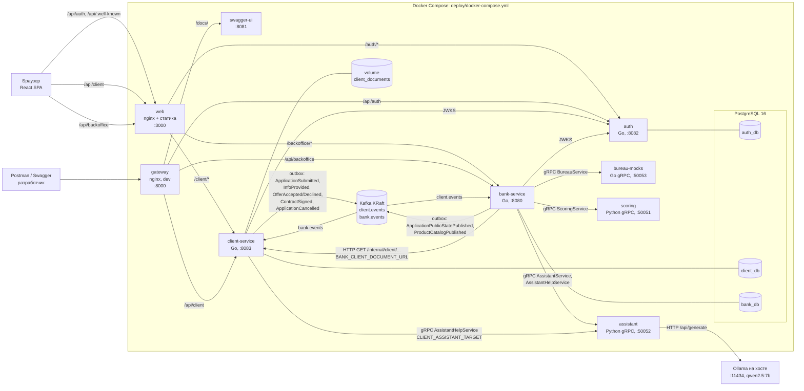
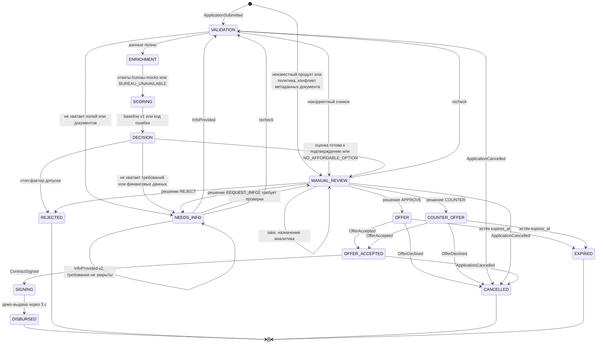
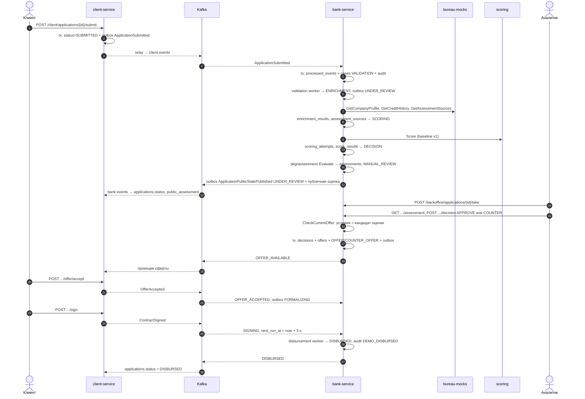

# Архитектура

Документ описывает фактическую топологию из `deploy/docker-compose.yml`, `deploy/nginx/*.conf` и кода сервисов. Контракты: OpenAPI в `api/*.yaml` (`auth`, `client`, `bank`, `assessment`, `common`), gRPC и события в `proto/*/*.proto`. Схемы БД — в [DATA_MODEL.md](DATA_MODEL.md), проверки — в [TEST_SCENARIOS.md](TEST_SCENARIOS.md).

## Компоненты

| Компонент | Порт на хосте | Ответственность |
|---|---|---|
| `web` | 3000 | Единая точка входа: статика React и прокси `/api/auth`, `/api/.well-known`, `/api/client`, `/api/backoffice` внутри compose-сети. Остальные `/api/*` → 404. |
| `gateway` | 8000 | Dev-шлюз для Swagger и Postman: `/docs/` → swagger-ui, `/api/auth`, `/api/client`, `/api/backoffice`, `/internal/*` (readyz) внутри compose-сети. |
| `swagger-ui` | 8081 | Swagger UI по `api/auth.yaml`, `client.yaml`, `bank.yaml`, `assessment.yaml`. |
| `auth` | 8082 | Логин, refresh-cookie, `me`, выпуск RS256 JWT, `/.well-known/jwks.json`. Роли `CLIENT`, `ANALYST`, `ADMIN`. БД `auth_db`. |
| `client-service` | 8083 | Профиль компании, каталог (проекция), черновики, документы, отправка и действия клиента, Help клиента, проекция публичной оценки. Файлы — в volume `client_documents`. БД `client_db`. |
| `bank-service` | 8080 | Конвейер дела (validation → enrichment → scoring → assessment), очередь и решения аналитика, повторная оценка, оферты, истечение, подпись, демо-выдача, аудит, публикация каталога. БД `bank_db`. |
| `bureau-mocks` | 50053 | gRPC-моки внешних источников по `seed/personas.yaml`: профиль компании, кредитная история, синтетические источники оценки. |
| `scoring` | 50051 | Python gRPC `ScoringService/Score`: детерминированная скоркарта `monotone-scorecard-v1` (`ml/scoring/models/scorecard-v1.json`). В v2 её результат хранится как `baseline_v1`. |
| `assistant` | 50052 | Python gRPC: `AssistantService` (резюме дела, текст решения) и `AssistantHelpService/Help`. Вызывает Ollama, при сбое — детерминированный шаблон. |
| `postgres` | 5432 | PostgreSQL 16.15, три БД с отдельными ролями (`deploy/postgres/init-dbs.sh`). |
| `kafka` | 9092 (внутри 19092) | Apache Kafka 3.9.2 KRaft, топики `client.events` и `bank.events` по одной партиции (`make infra-up`). |
| Ollama | 11434 | Запускается на хосте, не входит в compose. Модель по умолчанию `OLLAMA_MODEL=qwen2.5:7b`. |

Swagger UI ссылается на `/api/assessment.yaml`; в `deploy/nginx/nginx.conf` статическая раздача спецификаций ограничена `auth|client|bank|common`, поэтому Assessment and Help API надёжно открывается напрямую на `http://localhost:8081`.

## Ключевые свойства

* **Изоляция данных.** Каждый сервис владеет своей БД. Межбазовых внешних ключей нет (`org_id`, `client_user_id`, `assignee_id` — просто UUID). client-service и bank-service не читают чужие БД: состояние передаётся только событиями Kafka.
* **Outbox и идемпотентность.** Бизнес-изменение и событие пишутся в одной транзакции в таблицу `outbox`; relay публикует сохранённый protobuf `Event` без изменений, соблюдая порядок `aggregate_version`. Получатель вставляет `event_id` в `processed_events` в той же транзакции, что и изменение, и подтверждает offset Kafka после commit. Повторы HTTP-команд защищены `idempotency_keys` (заголовок `Idempotency-Key`), конкурентные изменения — `If-Match` с версией.
* **Защита документа.** Аналитик получает содержимое файла через bank-service: bank вызывает `GET /internal/client/applications/{id}/documents/{doc}/content` у client-service с токеном сотрудника (маршрут доступен только ролям staff) и сверяет SHA-256 с метаданными дела.
* **JWT.** auth подписывает access-токены, client-service и bank-service проверяют подпись по JWKS (`CLIENT_JWKS_URL`, `BANK_JWKS_URL`) с кешем.
* **Без автоматической оферты.** Конвейер v2 заканчивается в `MANUAL_REVIEW`, `NEEDS_INFO` или `REJECTED` (`services/bank-service/internal/repository/assessment/repository.go`, `RunOnce`). Положительный исход всегда подтверждает аналитик: решение `APPROVE`/`COUNTER` принимается только с условиями, совпадающими с актуальным кандидатом сохранённой оценки (`CheckCurrentOffer`); иначе 422. Прежний код автооферты в `repository/decision` не вызывается: worker решения делегирует в `assessmentrepository.RunOnce`.
* **LLM не принимает решений.** Модель только формулирует текст резюме, пояснения и Help из фактов, переданных backend. Для Help Qwen выбирает лишь разрешённые ID утверждений и действий из каталога `pkg/assistanthelp/catalog.json`; Go заново рендерит текст. Статус дела, сумма, ставка и исход модель не меняет. При недоступности модели используется шаблон.
* **Синтетические источники.** Все внешние сведения помечены `is_mock=true`; список моков — в `THIRD_PARTY_NOTICES.md`, раздел «Смоделированные интеграции».

## Статусы дела в bank-service

Допустимые значения — `CHECK` в `services/bank-service/migrations/00001_bank_init.sql`; переходы — предикаты `WHERE status = ...` в `services/bank-service/internal/repository/*`. `SUBMITTED` есть в ограничении и как значение по умолчанию, но код создаёт дело сразу в `VALIDATION` (или `MANUAL_REVIEW`).

Отзыв (`ApplicationCancelled`) принимается из любого статуса от `SUBMITTED` до `OFFER_ACCEPTED` включительно (`cancellableStatus` в `repository/receive/repository.go`); на схеме показаны три представителя. После `SIGNING` отзыв невозможен. Истечение оферты выполняет `offerexpiry` worker; ответ клиента после `expires_at` также переводит дело в `EXPIRED`. Recheck (`POST /backoffice/applications/{id}/recheck`) доступен назначенному аналитику, увеличивает `assessment_generation`, закрывает открытый запрос данных и повторяет конвейер с `VALIDATION`.

### Отображение для клиента

bank-service публикует клиенту только `ApplicationPublicStatePublished` с `ClientStatus` (`proto/events/events.proto`); client-service хранит его в `applications.status`. Скоринг, данные бюро и комментарии аналитика клиенту не передаются.

| Статус в bank_db | `ClientStatus` / `applications.status` | Событие публикует |
|---|---|---|
| — | `DRAFT` | только client-service |
| `SUBMITTED`, `VALIDATION` | `SUBMITTED` | client-service при отправке; банк ещё не публиковал состояние |
| `ENRICHMENT`, `SCORING`, `DECISION`, `MANUAL_REVIEW` | `UNDER_REVIEW` | validation (`UnderReview`), assessment и take (`ManualReview`/`UnderReview`), recheck |
| `NEEDS_INFO` | `NEEDS_INFO` | validation, assessment, решение `REQUEST_INFO` |
| `OFFER`, `COUNTER_OFFER` | `OFFER_AVAILABLE` | решение аналитика `APPROVE`/`COUNTER` |
| `OFFER_ACCEPTED`, `SIGNING` | `FORMALIZING` | ответ на оферту, подпись |
| `DISBURSED` | `DISBURSED` | disbursement worker |
| `REJECTED` | `REJECTED` | assessment или решение `REJECT` |
| `CANCELLED`, `EXPIRED` | `CLOSED` | отзыв, отказ от оферты, истечение |

Пока команда клиента не подтверждена банком, client-service не меняет последний подтверждённый статус, а ставит `pending_action`: `INFO_SENT`, `ACCEPT_PENDING`, `DECLINE_PENDING`, `SIGN_PENDING`, `CANCEL_PENDING`.

## Основной сквозной сценарий

Каждый переход в bank-service выполняется одной транзакцией: обновление `cases` с проверкой статуса и версии, запись `audit_log` и, если меняется публичное состояние, строка `outbox`. Worker'ы захватывают дела через `FOR UPDATE SKIP LOCKED` и lease (`lease_until`), поэтому повторный запуск не дублирует переход.
