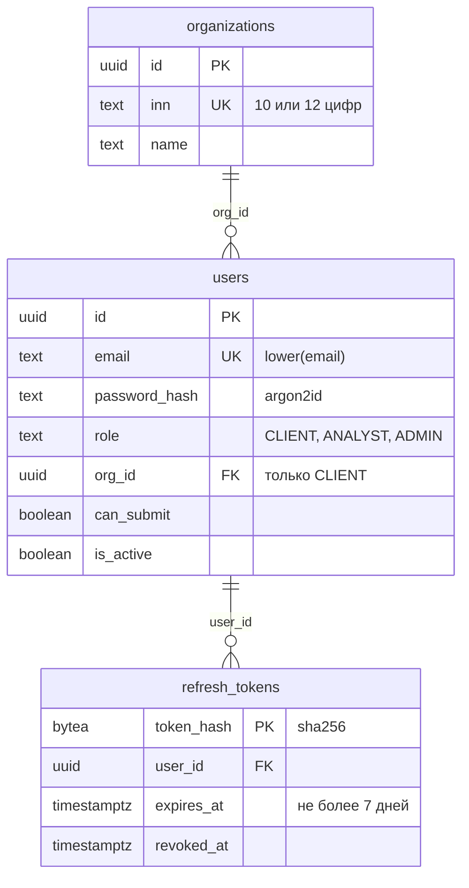
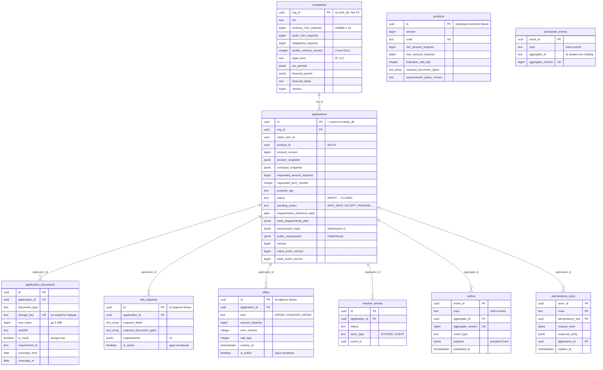
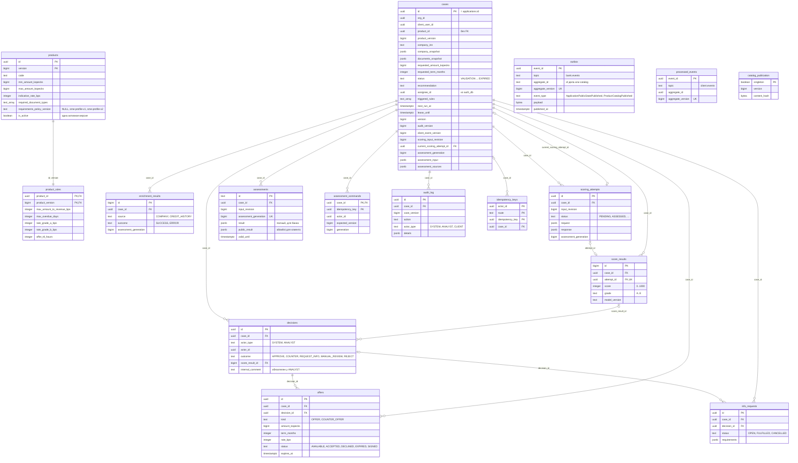

# Модель данных

Схемы построены по итоговому состоянию goose-миграций: `services/auth/migrations/00001`, `services/client-service/migrations/00001–00003`, `services/bank-service/migrations/00001–00007`. Показаны ключи, статусы, версии, деньги и связи; полный список колонок и `CHECK` — в миграциях.

Общие правила:

* три БД в одном PostgreSQL 16, у каждой свой владелец (`auth_user`, `client_user`, `bank_user`, см. `deploy/postgres/init-dbs.sh`);
* межбазовых внешних ключей нет; ID пользователей, организаций и заявок совпадают по значению, но целостность между БД обеспечивают события;
* деньги — `bigint` в копейках (`*_kopecks`), ставки — `integer` в базисных пунктах (`*_bps`);
* оптимистическая блокировка — колонка `version`; порядок событий — `aggregate_version`, `client_event_version`, `bank_event_version`;
* типы массивов на схемах записаны как `text_array`.

## auth_db

Владелец — `auth`. Только учётные записи и сессии; финансовых данных нет. Пароли хранятся как Argon2id PHC, refresh-токены — только SHA-256. Роль `CLIENT` обязана иметь `org_id`, `ANALYST`/`ADMIN` — нет.

## client_db

Владелец — `client-service`. Источник истины для профиля компании, черновика, загруженных файлов и действий клиента. Таблицы `products`, `info_requests`, `offers` и `applications.status` — проекции из `bank.events`; клиентская часть не видит скоринг, бюро и комментарии аналитика. Содержимое файлов лежит в volume по `storage_key`, в БД — метаданные и SHA-256.

## bank_db

Владелец — `bank-service`. Источник истины для продуктов и правил, дела (`cases.id` равен ID клиентской заявки), обогащения, скоринга, оценки v2, решений, оферт и аудита. Клиентские данные попадают сюда только как снимки (`company_snapshot`, `application_snapshot`, `documents_snapshot`) из событий `client.events`. `cases.product_id` намеренно без FK, чтобы дело с неизвестным продуктом попадало на ручной разбор.

Частичные уникальные индексы закрепляют инварианты: одна активная версия продукта (`products_one_active_code_idx`, `products_one_active_id_idx`), один открытый запрос данных (`info_requests_one_open_idx`), одна доступная оферта (`offers_one_available_idx`) на дело; в client_db — один активный запрос и одна активная оферта на заявку.
