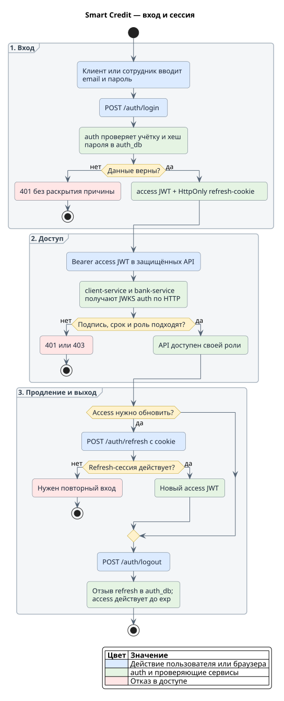
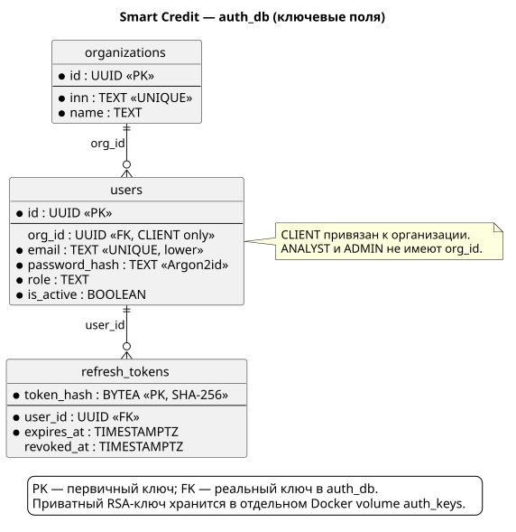

# auth

Сервис пользователей, сессий и публичных ключей по [`api/auth.yaml`](../../api/auth.yaml).

## Путь входа и сессии



[Исходник и сборка схемы](../../docs/diagrams/README.md). Клиент и сотрудник входят через `/auth/login`: успешный вход выдаёт короткий access JWT и HttpOnly refresh-cookie. С access JWT доступны `/auth/me` и защищённые API соответствующей роли; `client-service` и `bank-service` проверяют подпись через JWKS auth. `/auth/refresh` выдаёт новый access JWT по действующей cookie, `/auth/logout` отзывает refresh-сессию. Неверные учётные данные дают одинаковый `401`; отзыв refresh не аннулирует уже выданный access до его `exp`. Подробности TTL и cookie — ниже.

## Данные auth



[Исходник PlantUML](../../docs/diagrams/auth-db.puml) · [Миграция](migrations/00001_auth_init.sql).

Отдельная `auth_db` содержит `organizations` (организации клиента), `users` (учётки и роли) и `refresh_tokens` (хеши refresh-сессий). Приватный RSA-ключ хранится в отдельном Docker volume `auth_keys`, публичная часть выдаётся через JWKS. Структура и миграции — в [README схемы](migrations/README.md).


- `GET /healthz` — `204 No Content`, если процесс отвечает; БД не проверяется.
- `GET /readyz` — `204 No Content` при успешном ping `auth_db`, иначе `503`.
  Проверка ограничена `AUTH_READINESS_TIMEOUT`; тело ответа пустое.
- `GET /.well-known/jwks.json` — публичный RSA-ключ с `kid`, `alg=RS256`,
  `use=sig`, `n` и `e`; `Cache-Control: public, max-age=300`. Авторизация и БД
  для этого запроса не нужны.
- `POST /auth/login` — access JWT и refresh-cookie; неверный пароль,
  неизвестная или отключённая учётка дают одинаковый `401`.
- `POST /auth/refresh` — новый access JWT по действующей refresh-cookie.
- `POST /auth/logout` — отзыв refresh и очистка cookie, идемпотентный `204`.
- `GET /auth/me` — актуальный пользователь и его организация по Bearer JWT.

Сервис запускается при недоступном PostgreSQL и восстанавливает readiness после
возвращения БД. Приватный RSA-ключ загружается и проверяется при старте;
отсутствующий, повреждённый или неподходящий ключ останавливает запуск.
Readiness пока проверяет только соединение, без доступности таблиц.
`SIGINT`/`SIGTERM` запускают graceful shutdown HTTP с таймаутом
`AUTH_SHUTDOWN_TIMEOUT`, затем закрывается пул PostgreSQL. Логи процесса — JSON.
В каждый HTTP-ответ добавляется `X-Trace-ID`; ошибки содержат тот же `trace_id`.

## Запуск в Docker

Из корня репозитория добавьте блок `AUTH_*` из `.env.example` в `.env`:

```sh
make auth-up
```

Команда собирает target `auth` общего Dockerfile, создаёт RSA-ключ при первом
запуске, поднимает PostgreSQL, применяет миграции `auth_db` и ждёт успешного
`/readyz`. Внутри сети auth слушает `auth:8080`, с компьютера — `localhost:8082`.
Healthcheck проверяет `/readyz`; Kafka для auth не нужна.

Ключ хранится в volume `auth_keys` как `/var/lib/smart-credit/auth/private.pem`
с правами `0600`. Его создаёт пользователь `app`, от которого работает сервис;
ключ не копируется в образ. `make auth-keygen` сохраняет существующий файл.
Этот ключ независим от локального `.data/auth/private.pem`.
Issuer, audience, TTL, `kid` и cookie-настройки берутся из `AUTH_*`.

```sh
make auth-logs
make auth-down
```

`auth-down` удаляет контейнер, сохраняя ключ и БД с сессиями. Пересоздание
контейнера не меняет подпись: ранее выданные access и refresh продолжают работать.
`docker compose down -v` удаляет также ключ и данные — используйте его только
для удаления отдельного тестового окружения.

Для связки с клиентом и gateway:

```sh
make client-up
make gateway-up
```

`client-up` запускает auth с миграциями и ключом, затем клиент с его БД и Kafka.
Клиент получает JWKS напрямую по `http://auth:8080/.well-known/jwks.json`;
issuer и audience совпадают с auth. Swagger: `http://localhost:8000/docs/`.
Наружные пути — `/api/auth/*`, `/api/.well-known/*`, `/api/client/*`.
Nginx обновляет Docker DNS после пересоздания контейнера, не требуя reload.
Учётки при миграции не создаются. Для локальной демонстрации доступен отдельный
`make auth-dev-seed`, описанный ниже.

## Запуск Go-процесса на компьютере

Из корня репозитория добавьте блок `AUTH_*` из `.env.example` в свою `.env`.
Пароль в `AUTH_DATABASE_URL` должен совпадать с `AUTH_DB_PASSWORD`.
Для нового окружения создайте `.env` по примеру из корневого README.

Запустите PostgreSQL; init-скрипт нового тома создаёт `auth_db` и `auth_user`:

```sh
docker compose --env-file .env -f deploy/docker-compose.yml up -d postgres
make auth-db-up
```

Загрузите переменные. При первом запуске создайте постоянный ключ:

```sh
set -a
source .env
set +a
go run ./services/auth/cmd/keygen -out "$AUTH_JWT_PRIVATE_KEY_PATH"
```

Команда создаёт RSA-ключ 2048 бит в PKCS#8 PEM с правами `0600` и отказывается
перезаписывать существующий файл. Каталог `.data/auth/` исключён из Git.
Ключ создаётся один раз и сохраняется между перезапусками; для собственного пути
также исключите приватный файл из Git. Не передавайте его клиенту.

Запустите сервис из того же терминала:

```sh
go run ./services/auth/cmd/service
```

По умолчанию процесс слушает `:8082`. В другом терминале:

```sh
curl -i http://localhost:8082/healthz
curl -i http://localhost:8082/readyz
curl -i http://localhost:8082/.well-known/jwks.json
```

Через существующий gateway доступны `/internal/auth/healthz` и
`/internal/auth/readyz` на `http://localhost:8000`.
Gateway по умолчанию направляет auth/client в Docker. Для запуска Go-процессов
на компьютере обращайтесь к их портам напрямую; для refresh-cookie задайте
`AUTH_REFRESH_COOKIE_PATH=/auth`. Локальный клиент использует
`CLIENT_JWKS_URL=http://127.0.0.1:8082/.well-known/jwks.json` и те же issuer/audience,
что и локальный auth. При переходе между разными ключами перезапустите клиент,
чтобы очистить его кеш JWKS.

## Миграции

Схема `auth_db` содержит `organizations`, `users`, `refresh_tokens`.
Описание ограничений и команд отката — в [README миграций](migrations/README.md).
Статус миграций показывает `make auth-db-status`.

Миграция создаёт пустые таблицы; учётные записи загружаются отдельной командой.

## Локальные учётки

После `make auth-up` задайте в локальном `.env` три непустых пароля
`AUTH_DEV_ANALYST_PASSWORD`, `AUTH_DEV_ADMIN_PASSWORD` и
`AUTH_DEV_CLIENT_PASSWORD`, затем выполните:

```sh
make auth-dev-seed
```

Для проверки создания и повторного запуска в отдельной временной схеме
`auth_db` выполните `make auth-dev-seed-test`.

Команда создаёт в `auth_db` три организации и пять учёток с фиксированными UUID. Дополнительные клиентские персоны используют тот же `AUTH_DEV_CLIENT_PASSWORD`:

| Роль | Email | Демо-пароль в `.env` | UUID |
|---|---|---|---|
| ANALYST | `analyst@smart-credit.test` | `analyst` | `aaaaaaaa-aaaa-4aaa-8aaa-aaaaaaaaaaaa` |
| ADMIN | `admin@smart-credit.test` | `admin` | `bbbbbbbb-bbbb-4bbb-8bbb-bbbbbbbbbbbb` |
| CLIENT | `client@smart-credit.test` | `client` | `30000000-0000-4000-8000-000000000001` |
| CLIENT | `ip@smart-credit.test` | `client` | `30000000-0000-4000-8000-000000000002` |
| CLIENT | `closing@smart-credit.test` | `client` | `30000000-0000-4000-8000-000000000003` |

У основного клиента организация `20000000-0000-4000-8000-000000000001` и ИНН
`7707083893`; у ИП — организация `20000000-0000-4000-8000-000000000002` и ИНН `990000000115`, у персоны отказа —
организация `20000000-0000-4000-8000-000000000003` и ИНН `1111111117`. Основной ID совпадает с банковским demo seed.
Только роли CLIENT получают `org_id` и `can_submit=true`. Пароли хешируются штатным Argon2id-кодом auth и
не печатаются. Повторный запуск сверяет существующие записи и пароли, не меняя
их; несовпадение останавливает команду без частичных изменений. Пустые пароли
отклоняются до подключения к БД. Значения `client`, `admin`, `analyst` — публичные демонстрационные пароли, указанные в корневом README; реальные пароли и другие секреты не добавляйте в Git.
Команда изменяет только `auth_db`; профиль компании в `client_db` наполняется
отдельно клиентским контуром.

Если нужно заменить пароли этих локальных учёток, обновите значения в `.env`
и один раз выполните `AUTH_DEV_SEED_RESET_PASSWORDS=1 make auth-dev-seed`.
Команда перехеширует только изменившиеся пароли и удалит refresh-сессии
соответствующих пользователей. Уже выданные access JWT действуют до своего `exp`.

После загрузки войдите через Swagger `POST /auth/login`, используя email из
таблицы и соответствующий пароль из `.env`. Самостоятельной регистрации в MVP
нет: новые демонстрационные учётки добавляются через seed, а не HTTP API.

## Конфигурация

`AUTH_DATABASE_URL` обязателен. Остальные настройки имеют значения по умолчанию,
перечисленные в `.env.example`: HTTP-таймауты, параметры пула PostgreSQL,
readiness и shutdown. Конфигурация проверяет адрес сервера, PostgreSQL URL,
положительные таймауты и соотношение размеров пула.

Настройки JWT: issuer `smart-credit-auth`, audience `smart-credit`, access TTL
`15m`, `kid=auth-v1`, путь к приватному ключу `.data/auth/private.pem`.
Поддерживаются незашифрованные RSA PEM PKCS#1 и PKCS#8, от 2048 до 8192 бит.
Пара ключ/`kid` должна оставаться прежней между перезапусками. Автоматической
ротации и публикации предыдущих ключей пока нет.

## Пароли и access JWT

`internal/infra/password` создаёт Argon2id-хеши: версия 19, память 64 MiB,
три прохода, четыре потока, случайная соль 16 байт и результат 32 байта.
PHC-строка совместима с ограничением `users.password_hash`. Проверка использует
сравнение за постоянное время и ограничивает параметры PHC до 64 MiB, трёх
проходов и четырёх потоков перед вычислением хеша. Пароли не обрезаются и не
нормализуются.

`internal/infra/jwt` выпускает и локально проверяет RS256 access JWT.
В заголовке — `alg`, `typ=JWT`, `kid`; в payload — `sub`, `role`, `can_submit`,
`iss`, `aud`, `iat`, `exp`. Только CLIENT получает `org_id`; для ANALYST/ADMIN
организация отсутствует, `can_submit=false`. `expires_in` и `exp` используют
одинаковый TTL в целых секундах. JWKS содержит только публичные параметры.
Токены с неверными подписью, алгоритмом, ключом, issuer/audience, сроком или
сочетанием роли и организации отклоняются.

## Сессии

Login принимает JSON с `email` и `password`. Email приводится к нижнему регистру
и обрезается по краям; пароль сохраняет пробелы и регистр. Неизвестный пользователь
также проходит вычисление Argon2id с техническим хешем, который не хранится в БД.
Перед созданием сессии сервис повторно проверяет активность и парольный хеш под
блокировкой строки пользователя. JWT и cookie возвращаются только после commit.

Refresh-токен — 32 случайных байта в Base64URL без padding. В `refresh_tokens`
сохраняется только SHA-256 строки токена, пользователь и срок ровно семь суток.
Refresh не меняет токен, cookie или первоначальный срок; каждый раз читает
актуальные роль, организацию, `can_submit` и активность пользователя.
Отсутствующий, некорректный, неизвестный, истёкший или отозванный токен даёт `401`.

Refresh держит блокировку строк сессии и пользователя до завершения выпуска JWT;
logout и изменения пользователя дожидаются её освобождения. После сохранённого
отзыва эта сессия больше не выпускает access. Уже выданный access JWT действует
до своего `exp`: logout не добавляет его в blacklist.

Logout не требует access JWT. Отсутствующая, неизвестная или уже отозванная
refresh-cookie также даёт `204` и очищается. Ошибка БД возвращает `500`/`503` без
ложного подтверждения отзыва; cookie сохраняется для повторной попытки.

Все ответы `/auth/*`, включая ошибки, имеют `Cache-Control: no-store`.
Ошибки — `application/problem+json` с `trace_id`, без паролей, токенов и деталей БД.

Login ограничен десятью попытками в минуту с одного сетевого IP на процесс,
а также четырьмя одновременными обработками; превышение даёт `429` и
`Retry-After: 60`. Истёкшие записи лимитера удаляются при заполнении, размер
ограничен 4096 IP. Заголовкам `X-Forwarded-For`/`X-Real-IP` сервис не доверяет:
за gateway лимит применяется к его сетевому IP и разделяется пользователями.
Лимиты сбрасываются после перезапуска. JSON login ограничен 64 KiB;
лишние поля, несколько JSON-значений и неверный Content-Type дают `400`.

Refresh-cookie: имя `smart_credit_refresh`, путь `/api/auth`,
`HttpOnly`, `SameSite=Strict`. Для прямого обращения к auth задайте
`AUTH_REFRESH_COOKIE_PATH=/auth`, для HTTPS — `AUTH_REFRESH_COOKIE_SECURE=true`.
Имя и путь проходят проверку синтаксиса; префиксы `__Secure-` и `__Host-`
требуют соответствующих настроек безопасности.

## Текущий пользователь и HTTP

`GET /auth/me` принимает ровно один `Authorization: Bearer <access_token>`.
Подпись RS256, `kid`, issuer/audience, срок и claims проверяет локальный JWT-адаптер.
Refresh-cookie и токен в query не заменяют Bearer. Отсутствующий или неверный JWT,
удалённая либо отключённая учётка дают `401` с `WWW-Authenticate: Bearer`.

По проверенному `sub` сервис читает БД и возвращает `id`, `email`, `full_name`,
`role`, `can_submit`. У CLIENT есть `organization` с `id`, `inn`, `name`;
у ANALYST/ADMIN это поле отсутствует. Профиль, роль и права в ответе актуальны
на момент чтения БД, даже если JWT был выдан до изменения пользователя.
Query-параметры `user_id`/`org_id` не влияют на выбор пользователя.
Парольный хеш, активность и данные сессий в ответ не попадают.

Все ошибки маршрутизации также используют `application/problem+json`:
`404 NOT_FOUND`, `405 METHOD_NOT_ALLOWED` с `Allow`. Ошибки подключения к БД,
таймауты и временные сбои PostgreSQL дают `503 UNAVAILABLE`; прочие внутренние
ошибки дают `500 INTERNAL_ERROR`. Детали драйвера не передаются клиенту.

Входящий `X-Trace-ID` сохраняется, если это единственный ненулевой UUID;
иначе создаётся новый. Он совпадает в заголовке, `problem.trace_id` и логах.
JSON-лог запроса содержит метод, шаблон маршрута, статус, длительность и trace ID.
В него не входят URL/query, body, заголовки, cookie или профиль пользователя;
для неизвестного маршрута записывается `<unmatched>`.

Panic до отправки ответа превращается в безопасный `500` с запретом кеширования;
незавершённые заголовки, включая `Set-Cookie`, удаляются. Если ответ уже начат,
соединение прерывается, чтобы не дописывать второй JSON. Значение panic в лог не
попадает. Health и JWKS, а также login/refresh/logout остаются публичными.

## Проверки

```sh
go test ./services/auth/...
```

SQL-проверки запускаются отдельно:

```sh
make auth-db-test
```

Unit/SQL-тесты с интеграционными сценариями сессий и race detector:

```sh
AUTH_TEST_DATABASE_URL="$AUTH_DATABASE_URL" make auth-test
```

Они проверяют ограничения ролей и организаций, email без учёта регистра,
refresh-хеши и сроки, откат миграции, цикл login/refresh/logout для всех ролей,
смену прав, отключение учётки, откат при ошибке commit и блокировку отзыва во
время refresh. `/auth/me` проверяется для всех ролей, после изменения профиля,
организации, роли, отключения и удаления пользователя. HTTP-тесты проверяют
JWT, trace ID, безопасные логи, recovery и `404/405`.
Без `AUTH_TEST_DATABASE_URL` SQL-тесты пропускаются. Для каждого теста
создаётся отдельная схема; существующие таблицы auth не затрагиваются.
`make auth-test` требует эту переменную и завершится ошибкой без неё или при
недоступной БД. Docker smoke-тест исключён из этого прогона и запускается отдельно.

Для автоматического Docker smoke-прогона нужны Docker Compose с поддержкой
`!override`/`!reset`, Go из `go.mod`, make и Python 3:

```sh
make auth-smoke-test
```

Команда создаёт отдельный проект `smart-credit-auth-smoke-*`, использует только
настройки из `.env.example`, временные файлы и динамические порты. Собирает auth
и client-service, поднимает PostgreSQL/Kafka/gateway/Swagger, применяет миграции,
создаёт топики и запускает существующий `TestDockerAuthClientIntegration` с
`-race`. В конце, включая ошибку, удаляет только свой проект и его volumes;
при ошибке сначала выводит логи. Обычный `.env` и рабочий стенд не меняются.

CI `.github/workflows/auth.yml` запускается при push/PR с изменениями auth или
его зависимостей и вручную. Первое задание поднимает PostgreSQL 16.15, выполняет
`make auth-test`, lint и проверку Compose. После его успеха второе задание
выполняет `make auth-smoke-test`. Таким образом проверяются все существующие
тесты auth, включая Docker-интеграцию и сохранение ключа/сессий после рестарта.

Docker smoke-тест `TestDockerAuthClientIntegration` запускается отдельно при
заданных переменных для уже запущенного отдельного окружения:

| Переменная | Значение |
|---|---|
| `AUTH_DOCKER_TEST_URL` | URL gateway без завершающего `/` |
| `AUTH_DOCKER_TEST_PROJECT` | Имя отдельного проекта `smart-credit-auth-smoke-*` |
| `AUTH_DOCKER_TEST_ENV` | Абсолютный путь к env-файлу этого проекта |
| `AUTH_DOCKER_TEST_OVERRIDE` | Абсолютный путь к Compose override с незанятыми портами |
| `AUTH_DOCKER_TEST_DATABASE_URL` | DSN тестовой `auth_db` с компьютера |
| `CLIENT_DOCKER_TEST_DATABASE_URL` | DSN тестовой `client_db` с компьютера |

```sh
go test -count=1 -timeout 4m -run '^TestDockerAuthClientIntegration$' ./services/auth/internal/container
```

Он создаёт временные учётки и компании, проверяет login/me/refresh/logout,
JWT клиента и изоляцию организаций, затем пересоздаёт auth и клиент и проверяет
старые токены. Фикстуры удаляются; демоучётки не устанавливаются.
